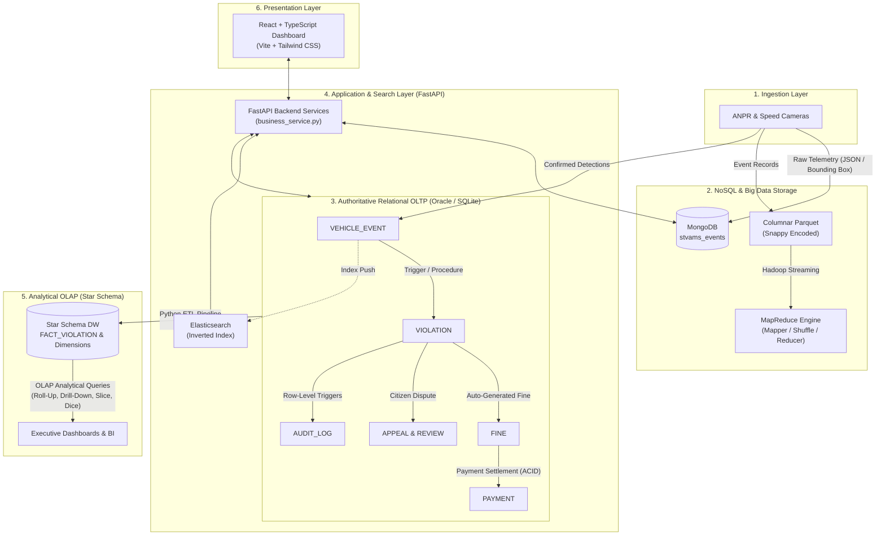
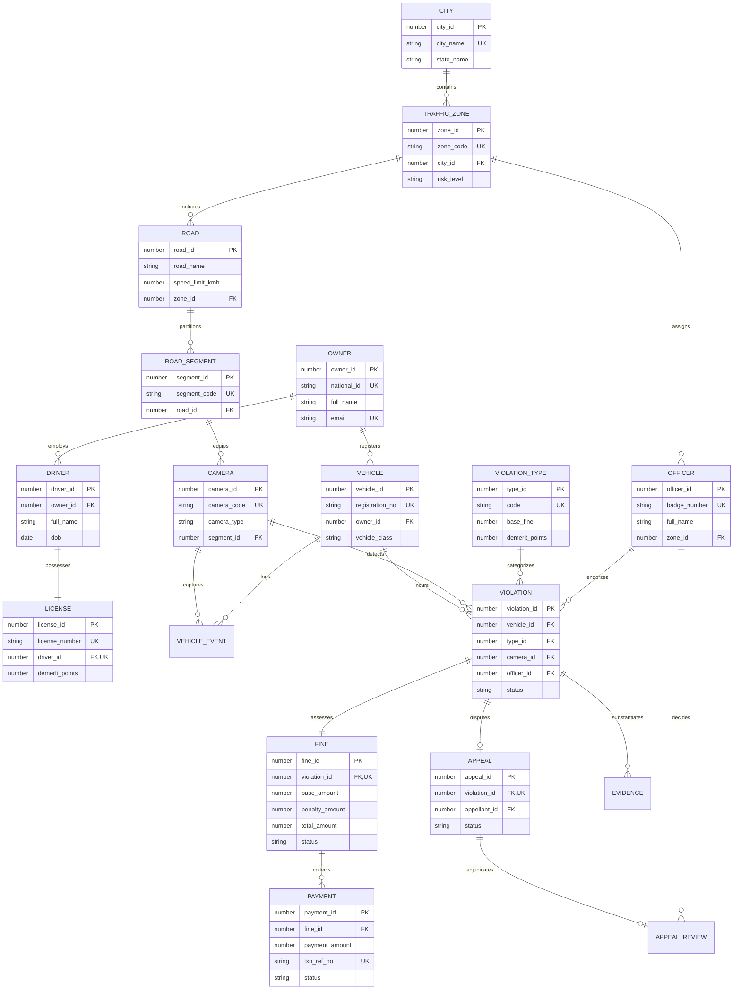

# STVAMS: Complete DBMS Concept-to-Code Mapping Guide

**Project:** Smart Traffic Violation & Vehicle Analytics Management System (STVAMS)  
**Target Audience:** Project Author & Examination Faculty (Viva Voce & Lab Assessment)  
**System Type:** Enterprise Polyglot DBMS (Relational SQL + PL/SQL + NoSQL MongoDB + Dimensional Star Schema OLAP + Big Data MapReduce & Columnar Parquet)  
**Repository Working Directory:** `c:\Users\amogh\Documents\GitHub\DBMS-Project`  

---

## A. Project Database Architecture

### 1. Storage Systems & Databases Overview

STVAMS uses a polyglot persistence architecture designed to solve specific operational, analytical, and velocity constraints:

1. **Primary Operational Relational Database (Oracle 19c / 21c with Local SQLite Fallback):**
   - **Role:** System of record for structured entities requiring strict ACID guarantees and referential integrity (vehicles, owners, drivers, traffic zones, violation citations, fines, audit logs, and payments).
   - **Engine:** Oracle SQL & PL/SQL (`oracledb`), with automatic development fallback to SQLite (`sqlite3` / `stvams_dev.db`) handled in [`backend/app/db/database.py`](file:///c:/Users/amogh/Documents/GitHub/DBMS-Project/backend/app/db/database.py#L18-L42).
   - **Entities:** 22 relational tables normalized up to Boyce-Codd Normal Form (BCNF).

2. **Semi-Structured Document Store (NoSQL MongoDB):**
   - **Role:** High-velocity ingestion of heterogeneous ANPR and speed camera detection telemetry, bounding boxes, OCR confidence scores, and raw metadata.
   - **Database & Collection:** `stvams_events.detection_events`.
   - **Integration:** [`database/mongodb/seed.js`](file:///c:/Users/amogh/Documents/GitHub/DBMS-Project/database/mongodb/seed.js#L8-L40), [`database/mongodb/mongodb_queries.js`](file:///c:/Users/amogh/Documents/GitHub/DBMS-Project/database/mongodb/mongodb_queries.js#L8-L95), and [`backend/app/routers/evidence.py`](file:///c:/Users/amogh/Documents/GitHub/DBMS-Project/backend/app/routers/evidence.py#L11-L62).

3. **Inverted Index Full-Text Search Engine (Elasticsearch):**
   - **Role:** Sub-second multi-field keyword and license plate search over large violation datasets without incurring expensive SQL table scans.
   - **Integration:** [`backend/app/routers/search.py`](file:///c:/Users/amogh/Documents/GitHub/DBMS-Project/backend/app/routers/search.py#L10-L48) with automatic fallback to relational SQL joins if Elasticsearch is offline.

4. **Dimensional Data Warehouse & OLAP Engine (Star Schema):**
   - **Role:** Long-term historical trend analysis, revenue roll-ups, and risk profiling isolated from live OLTP tables.
   - **Schema:** 6 Dimension tables (`DIM_DATE`, `DIM_TIME`, `DIM_VEHICLE`, `DIM_CAMERA`, `DIM_ZONE`, `DIM_VIOLATION_TYPE`) and 2 Fact tables (`FACT_VIOLATION`, `FACT_PAYMENT`).
   - **Pipeline & Queries:** [`database/warehouse/schema.sql`](file:///c:/Users/amogh/Documents/GitHub/DBMS-Project/database/warehouse/schema.sql#L9-L94), [`database/warehouse/etl.py`](file:///c:/Users/amogh/Documents/GitHub/DBMS-Project/database/warehouse/etl.py#L29-L236), and [`database/warehouse/olap_queries.sql`](file:///c:/Users/amogh/Documents/GitHub/DBMS-Project/database/warehouse/olap_queries.sql#L8-L78).

5. **Big Data Columnar Storage & Batch Analytics (Apache Parquet & MapReduce):**
   - **Role:** Analytical columnar compression (Snappy) and distributed streaming computation for zone-wise violation count and speed aggregations.
   - **Implementation:** [`backend/app/integrations/parquet/parquet_export.py`](file:///c:/Users/amogh/Documents/GitHub/DBMS-Project/backend/app/integrations/parquet/parquet_export.py#L12-L82), [`bigdata/mapreduce/mapper.py`](file:///c:/Users/amogh/Documents/GitHub/DBMS-Project/bigdata/mapreduce/mapper.py#L16-L60), [`bigdata/mapreduce/reducer.py`](file:///c:/Users/amogh/Documents/GitHub/DBMS-Project/bigdata/mapreduce/reducer.py#L15-L85), and [`bigdata/mapreduce/driver.py`](file:///c:/Users/amogh/Documents/GitHub/DBMS-Project/bigdata/mapreduce/driver.py#L21-L89).

---

### 2. End-to-End Data Lifecycle Flow

---

## B. DBMS Concepts and Their Exact Code Locations

| DBMS Concept | Exact File Path | Actual Code/Object | What It Does | How It Is Used in STVAMS |
|---|---|---|---|---|
| **Relational Data Model & DDL** | [`database/oracle/01_schema.sql`](file:///c:/Users/amogh/Documents/GitHub/DBMS-Project/database/oracle/01_schema.sql#L25-L305) | `CREATE TABLE CITY`, `TRAFFIC_ZONE`, `ROAD`, `CAMERA`, `VEHICLE`, `VIOLATION`, `FINE`, `PAYMENT` | Defines physical tables, column data types, NULL-ability, and storage specifications | Forms the 22-entity backbone of the traffic management database |
| **Primary Keys (Identity & Surrogate)** | [`database/oracle/01_schema.sql`](file:///c:/Users/amogh/Documents/GitHub/DBMS-Project/database/oracle/01_schema.sql#L26-L35) | `NUMBER GENERATED BY DEFAULT AS IDENTITY PRIMARY KEY` | Enforces entity integrity, uniqueness, and creates implicit primary B-tree indexes | Uniquely identifies each city, zone, camera, vehicle, and citation record |
| **Foreign Keys & Referential Integrity** | [`database/oracle/01_schema.sql`](file:///c:/Users/amogh/Documents/GitHub/DBMS-Project/database/oracle/01_schema.sql#L41-L42) | `CONSTRAINT fk_zone_city FOREIGN KEY (city_id) REFERENCES CITY(city_id) ON DELETE CASCADE` | Enforces referential integrity between parent and child tables | Prevents orphaned records; cascades deletion across municipal hierarchies |
| **CHECK Constraints (Domain Integrity)** | [`database/oracle/01_schema.sql`](file:///c:/Users/amogh/Documents/GitHub/DBMS-Project/database/oracle/01_schema.sql#L39-L50) | `CHECK (risk_level IN ('LOW', 'MEDIUM', 'HIGH', 'CRITICAL'))`, `CHECK (speed_limit_kmh > 0 AND speed_limit_kmh <= 200)` | Validates permissible domain ranges and discrete value sets at insertion time | Prevents nonsensical speed limits, invalid camera states, or incorrect risk tiers |
| **Cross-Column Date Checks** | [`database/oracle/01_schema.sql`](file:///c:/Users/amogh/Documents/GitHub/DBMS-Project/database/oracle/01_schema.sql#L130-L158) | `CONSTRAINT chk_license_dates CHECK (expiry_date > issue_date)`, `chk_ins_dates` | Enforces business consistency rules across multiple date columns in a single row | Guarantees license and insurance policies expire strictly after issuance |
| **Regex & Pattern Constraints** | [`database/oracle/02_constraints.sql`](file:///c:/Users/amogh/Documents/GitHub/DBMS-Project/database/oracle/02_constraints.sql#L14-L28) | `REGEXP_LIKE(email, '^[A-Za-z0-9._%+-]+@...')`, `REGEXP_LIKE(registration_no, '^[A-Z]{2}[0-9]{2}[A-Z]{1,2}[0-9]{4}$')` | Performs regular expression validation on text input strings | Validates Indian RTO vehicle plate syntax (`MH01AB1234`) and officer badge formats (`TR-1001`) |
| **Virtual / Computed Columns** | [`database/oracle/01_schema.sql`](file:///c:/Users/amogh/Documents/GitHub/DBMS-Project/database/oracle/01_schema.sql#L239) | `total_amount NUMBER(10,2) GENERATED ALWAYS AS (base_amount + penalty_amount)` | Calculates total sum automatically on the fly without redundant manual updates | Guarantees the fine total ledger mathematically matches base plus penalty |
| **SQL DML (INSERT, UPDATE, DELETE)** | [`database/oracle/03_seed_data.sql`](file:///c:/Users/amogh/Documents/GitHub/DBMS-Project/database/oracle/03_seed_data.sql#L10-L100) & [`14_practical_queries.sql`](file:///c:/Users/amogh/Documents/GitHub/DBMS-Project/database/oracle/14_practical_queries.sql#L175-L185) | `INSERT INTO VEHICLE ...`, `UPDATE FINE SET status = 'OVERDUE' ...`, `DELETE FROM CAMERA_MAINTENANCE` | Modifies relation states | Handles record lifecycle updates and data seeding |
| **Multi-Table Inner Joins** | [`database/oracle/14_practical_queries.sql`](file:///c:/Users/amogh/Documents/GitHub/DBMS-Project/database/oracle/14_practical_queries.sql#L95-L98) | `SELECT v.registration_no, o.full_name FROM VEHICLE v INNER JOIN OWNER o ON v.owner_id = o.owner_id` | Combines matching tuples across relations based on equality predicates | Links vehicles to their registered owners and addresses |
| **Outer Joins (LEFT, RIGHT, FULL)** | [`database/oracle/14_practical_queries.sql`](file:///c:/Users/amogh/Documents/GitHub/DBMS-Project/database/oracle/14_practical_queries.sql#L101-L113) | `LEFT OUTER JOIN CAMERA_MAINTENANCE`, `RIGHT OUTER JOIN OFFICER`, `FULL OUTER JOIN DRIVER` | Preserves unmatched rows from either or both joined tables | Identifies cameras without maintenance history or officers without citations |
| **Self Join** | [`database/oracle/14_practical_queries.sql`](file:///c:/Users/amogh/Documents/GitHub/DBMS-Project/database/oracle/14_practical_queries.sql#L125-L127) | `FROM OWNER o1 JOIN OWNER o2 ON o1.address = o2.address AND o1.owner_id <> o2.owner_id` | Joins a table to itself to compare records within the same entity | Finds cohabiting owners sharing the exact registered home address |
| **Non-Equijoin** | [`database/oracle/14_practical_queries.sql`](file:///c:/Users/amogh/Documents/GitHub/DBMS-Project/database/oracle/14_practical_queries.sql#L116-L122) | `WHERE ve.observed_speed > r.speed_limit_kmh` | Joins tuples using inequality operators (`>`, `<`, `<>`) | Evaluates speeding event infractions relative to the designated road speed limit |
| **Aggregate Functions & GROUP BY** | [`database/oracle/14_practical_queries.sql`](file:///c:/Users/amogh/Documents/GitHub/DBMS-Project/database/oracle/14_practical_queries.sql#L64-L73) | `SELECT camera_id, COUNT(event_id), ROUND(AVG(observed_speed), 2) FROM VEHICLE_EVENT GROUP BY camera_id` | Partitions rows into groups and computes summary statistics | Calculates traffic flow volume, maximum speed, and average velocity per camera sensor |
| **HAVING Clause Filtering** | [`database/oracle/14_practical_queries.sql`](file:///c:/Users/amogh/Documents/GitHub/DBMS-Project/database/oracle/14_practical_queries.sql#L72) & [`business_service.py`](file:///c:/Users/amogh/Documents/GitHub/DBMS-Project/backend/app/services/business_service.py#L161) | `HAVING COUNT(viol.violation_id) >= 2` | Filters aggregated group partitions after grouping | Flags high-risk repeat offenders having multiple infractions |
| **Set Operators (UNION, INTERSECT, MINUS)** | [`database/oracle/14_practical_queries.sql`](file:///c:/Users/amogh/Documents/GitHub/DBMS-Project/database/oracle/14_practical_queries.sql#L76-L94) | `SELECT registration_no FROM VEHICLE UNION / INTERSECT / MINUS SELECT license_plate_raw FROM VEHICLE_EVENT` | Combines or differentiates tuple sets across tables | Identifies unregistered vehicles detected by cameras, and registered cars with zero events |
| **Correlated Subqueries (`EXISTS`, `NOT EXISTS`)** | [`database/oracle/14_practical_queries.sql`](file:///c:/Users/amogh/Documents/GitHub/DBMS-Project/database/oracle/14_practical_queries.sql#L152-L165) | `WHERE NOT EXISTS (SELECT 1 FROM VEHICLE v WHERE v.owner_id = o.owner_id)` | Evaluates inner query dynamically for each candidate row of outer query | Discovers vehicle owners who have never registered a vehicle or incurred a citation |
| **Subqueries with Set Predicates (`IN`, `ANY`, `ALL`)** | [`database/oracle/14_practical_queries.sql`](file:///c:/Users/amogh/Documents/GitHub/DBMS-Project/database/oracle/14_practical_queries.sql#L134-L150) | `total_amount > ANY (...)`, `total_amount >= ALL (...)` | Evaluates multi-row comparisons against nested result sets | Categorizes fines exceeding any minor offense or all severe offense baselines |
| **Analytical Window Functions** | [`database/oracle/14_practical_queries.sql`](file:///c:/Users/amogh/Documents/GitHub/DBMS-Project/database/oracle/14_practical_queries.sql#L188-L194) | `DENSE_RANK() OVER (ORDER BY COUNT(viol.violation_id) DESC) AS rank_in_city` | Computes ranking across partitioned row sets without collapsing rows | Ranks worst repeat offending vehicles across municipal jurisdiction |
| **Database Views (Complex & Analytical)** | [`database/oracle/04_views.sql`](file:///c:/Users/amogh/Documents/GitHub/DBMS-Project/database/oracle/04_views.sql#L9-L78) | `CREATE VIEW VW_VEHICLE_VIOLATION_SUMMARY`, `VW_PENDING_FINES`, `VW_TRAFFIC_HOTSPOTS` | Provides simplified, abstracted virtual tables encapsulating multi-table joins | Serves pre-joined summaries to the frontend without repeating raw joins |
| **Updatable View with `WITH CHECK OPTION`** | [`database/oracle/04_views.sql`](file:///c:/Users/amogh/Documents/GitHub/DBMS-Project/database/oracle/04_views.sql#L95-L99) | `CREATE VIEW VW_ACTIVE_OFFICERS ... WITH CHECK OPTION` | Restricts view modifications ensuring newly written tuples satisfy the `WHERE` filter | Prevents accidentally setting officer status to inactive through the active view |
| **INSTEAD OF Trigger on Complex Views** | [`database/oracle/04_views.sql`](file:///c:/Users/amogh/Documents/GitHub/DBMS-Project/database/oracle/04_views.sql#L113-L125) | `CREATE TRIGGER TRG_VW_OWNER_VEHICLE_UPDATE INSTEAD OF UPDATE ON VW_OWNER_VEHICLE_MINIMAL` | Overrides standard view update restriction by manually rerouting updates to base tables | Allows updating joined multi-table views safely by decoupling base table updates |
| **Secondary & Composite Indexes** | [`database/oracle/05_indexes.sql`](file:///c:/Users/amogh/Documents/GitHub/DBMS-Project/database/oracle/05_indexes.sql#L9-L26) | `CREATE INDEX IDX_VIOL_VEH_DATE ON VIOLATION(vehicle_id, violation_dt)`, `IDX_FINE_STATUS_DUE` | Creates balanced B-tree index structures on high-cardinality multi-column query keys | Eliminates full table scans when querying unpaid fines by due date |
| **Function-Based Indexes** | [`database/oracle/05_indexes.sql`](file:///c:/Users/amogh/Documents/GitHub/DBMS-Project/database/oracle/05_indexes.sql#L30-L31) | `CREATE INDEX IDX_VEHICLE_REG_UPPER ON VEHICLE(UPPER(registration_no))` | Indexes the computed expression result for case-insensitive indexing | Enables fast indexed lookups when users search case-insensitively for license plates |
| **Stored Procedures (DML & Control)** | [`database/oracle/06_procedures.sql`](file:///c:/Users/amogh/Documents/GitHub/DBMS-Project/database/oracle/06_procedures.sql#L11-L68) | `PROCEDURE REGISTER_VEHICLE`, `REGISTER_VIOLATION`, `GENERATE_FINE` | Encapsulates server-side procedural logic, parameter validation, and transactional DML | Ensures standardized vehicle onboarding and synchronized citation creation |
| **ACID Transaction & Savepoints** | [`database/oracle/06_procedures.sql`](file:///c:/Users/amogh/Documents/GitHub/DBMS-Project/database/oracle/06_procedures.sql#L102-L152) & [`10_transactions.sql`](file:///c:/Users/amogh/Documents/GitHub/DBMS-Project/database/oracle/10_transactions.sql#L15-L37) | `SAVEPOINT sp_start_payment`, `COMMIT`, `ROLLBACK TO ...` | Guarantees Atomicity, Consistency, Isolation, and Durability | Safely processes citizen fine payments; rolls back entire transaction upon validation error |
| **Row-Level Pessimistic Locking** | [`database/oracle/06_procedures.sql`](file:///c:/Users/amogh/Documents/GitHub/DBMS-Project/database/oracle/06_procedures.sql#L119) | `SELECT status, total_amount INTO ... FROM FINE WHERE fine_id = p_fine_id FOR UPDATE` | Locks the targeted row exclusively until transaction completion | Prevents race conditions and double payments by concurrent payment channels |
| **User-Defined Functions (PL/SQL)** | [`database/oracle/07_functions.sql`](file:///c:/Users/amogh/Documents/GitHub/DBMS-Project/database/oracle/07_functions.sql#L9-L38) | `FUNCTION CALCULATE_FINE (type_id, observed_speed, speed_limit) RETURN NUMBER` | Computes and returns scalar values directly callable within SQL SELECT queries | Dynamically calculates speed escalation penalties (1.5x / 2.5x base fine) |
| **Implicit Cursors** | [`database/oracle/08_cursors.sql`](file:///c:/Users/amogh/Documents/GitHub/DBMS-Project/database/oracle/08_cursors.sql#L11-L24) | `SQL%FOUND`, `SQL%NOTFOUND`, `SQL%ROWCOUNT` | Inspects system feedback and row count affected by most recent implicit DML execution | Verifies how many fine records were updated during overdue batch runs |
| **Explicit Cursors (Lifecycle)** | [`database/oracle/08_cursors.sql`](file:///c:/Users/amogh/Documents/GitHub/DBMS-Project/database/oracle/08_cursors.sql#L29-L51) | `CURSOR c_unpaid_fines IS ... OPEN ... FETCH ... EXIT WHEN %NOTFOUND ... CLOSE` | Sequentially processes query result sets row by row in memory | Iterates through overdue fines to generate citizen SMS/email notification dispatches |
| **Parameterized Cursors** | [`database/oracle/08_cursors.sql`](file:///c:/Users/amogh/Documents/GitHub/DBMS-Project/database/oracle/08_cursors.sql#L55-L75) | `CURSOR c_zone_violations (p_zone_id NUMBER) IS ...` | Accepts dynamic input arguments to filter cursor query result sets | Dynamically iterates through violations within a specific traffic zone |
| **Cursor FOR Loops** | [`database/oracle/08_cursors.sql`](file:///c:/Users/amogh/Documents/GitHub/DBMS-Project/database/oracle/08_cursors.sql#L79-L93) | `FOR rec IN (SELECT ... GROUP BY HAVING ...) LOOP` | Automatically opens, fetches, and closes cursors, preventing resource leaks | Streams top repeat offending vehicles into the administrative report log |
| **REF CURSORs (`SYS_REFCURSOR`)** | [`database/oracle/08_cursors.sql`](file:///c:/Users/amogh/Documents/GitHub/DBMS-Project/database/oracle/08_cursors.sql#L96-L109) | `PROCEDURE GET_VIOLATIONS_BY_STATUS (p_status, p_cursor OUT SYS_REFCURSOR)` | Returns dynamic runtime query pointers to external host client programs | Allows backend or reporting clients to fetch active cursor result sets dynamically |
| **BEFORE Row-Level Triggers** | [`database/oracle/09_triggers.sql`](file:///c:/Users/amogh/Documents/GitHub/DBMS-Project/database/oracle/09_triggers.sql#L9-L21) | `TRIGGER TRG_BEFORE_VIOLATION_INSERT BEFORE INSERT ON VIOLATION FOR EACH ROW` | Intercepts insertion tuple before it writes to disk; inspects `:NEW` values | Rejects citation generation on vehicles marked as scrapped or de-registered |
| **AFTER Row-Level Triggers** | [`database/oracle/09_triggers.sql`](file:///c:/Users/amogh/Documents/GitHub/DBMS-Project/database/oracle/09_triggers.sql#L24-L41) | `TRIGGER TRG_AFTER_VIOLATION_INSERT AFTER INSERT ON VIOLATION FOR EACH ROW` | Fires immediately following tuple insertion; reads `:NEW` pseudo-columns | Automatically inserts a corresponding fine in `FINE` and writes an entry in `AUDIT_LOG` |
| **Audit Trails & Change Logging** | [`database/oracle/09_triggers.sql`](file:///c:/Users/amogh/Documents/GitHub/DBMS-Project/database/oracle/09_triggers.sql#L44-L59) | `TRIGGER TRG_AFTER_PAYMENT_AUDIT ... INSERT INTO AUDIT_LOG` | Records `:OLD` and `:NEW` states, timestamp, and active user to an audit table | Maintains a tamper-evident audit history of all payment status alterations |
| **Statement-Level Triggers** | [`database/oracle/09_triggers.sql`](file:///c:/Users/amogh/Documents/GitHub/DBMS-Project/database/oracle/09_triggers.sql#L62-L68) | `TRIGGER TRG_STATEMENT_CAMERA_MAINT AFTER UPDATE OF status ON CAMERA` | Fires once per DML statement regardless of how many individual rows changed | Logs bulk camera status adjustments to administrative alerts |
| **Query Processing & EXPLAIN PLAN** | [`database/oracle/11_query_processing.sql`](file:///c:/Users/amogh/Documents/GitHub/DBMS-Project/database/oracle/11_query_processing.sql#L14-L22) | `EXPLAIN PLAN FOR SELECT ... SELECT * FROM TABLE(DBMS_XPLAN.DISPLAY);` | Shows execution plan: cost-based optimization (CBO), access paths, and join methods | Analyzes query parse tree, hash joins, and cost overhead |
| **Cost-Based Query Optimization** | [`database/oracle/12_query_optimization.sql`](file:///c:/Users/amogh/Documents/GitHub/DBMS-Project/database/oracle/12_query_optimization.sql#L11-L24) | `SELECT /*+ FULL(ve) */ ...` vs `SELECT /*+ INDEX(ve IDX_EVENT_CAM_STATUS) */` | Compares execution costs between unindexed full table scans and index lookups | Demonstrates how optimizer hints and composite indexes cut down physical I/O |
| **Data Control Language (DCL) & RBAC** | [`database/oracle/13_dcl.sql`](file:///c:/Users/amogh/Documents/GitHub/DBMS-Project/database/oracle/13_dcl.sql#L9-L49) | `CREATE ROLE ROLE_TRAFFIC_OFFICER`, `GRANT SELECT, INSERT ON ...`, `REVOKE ...` | Implements Role-Based Access Control and principle of least privilege | Grants officers citation rights while restricting analysts to read-only views |
| **NoSQL CRUD & Embedded Documents** | [`database/mongodb/mongodb_queries.js`](file:///c:/Users/amogh/Documents/GitHub/DBMS-Project/database/mongodb/mongodb_queries.js#L11-L69) | `db.detection_events.insertOne({...})`, `find({"camera.type": "ANPR"})`, `updateOne` | Manages flexible hierarchical documents with subdocuments and arrays | Ingests camera metadata, OCR confidence, bounding boxes, and camera hardware specs |
| **NoSQL Aggregation Pipeline** | [`database/mongodb/mongodb_queries.js`](file:///c:/Users/amogh/Documents/GitHub/DBMS-Project/database/mongodb/mongodb_queries.js#L84-L95) | `db.detection_events.aggregate([{ $match: ... }, { $group: ... }, { $sort: ... }])` | Executes multi-stage data processing pipeline over document streams | Calculates average observed speed and event count grouped by camera code |
| **Data Warehouse Dimensional Model** | [`database/warehouse/schema.sql`](file:///c:/Users/amogh/Documents/GitHub/DBMS-Project/database/warehouse/schema.sql#L9-L94) | `DIM_DATE`, `DIM_TIME`, `DIM_VEHICLE`, `DIM_ZONE`, `FACT_VIOLATION`, `FACT_PAYMENT` | Implements Star Schema with surrogate keys and additive/semi-additive measures | Segregates heavy historical analytical aggregation from the live OLTP database |
| **Warehouse ETL Pipeline (Python)** | [`database/warehouse/etl.py`](file:///c:/Users/amogh/Documents/GitHub/DBMS-Project/database/warehouse/etl.py#L46-L224) | `run_etl()`: Extract OLTP tuples -> Transform Dimensions/Facts -> Load Star Schema | Extracts operational entities, computes surrogate keys, and populates fact tables | Bridges transactional operational storage and dimensional OLAP storage |
| **OLAP Operations (Roll-Up, Drill-Down)** | [`database/warehouse/olap_queries.sql`](file:///c:/Users/amogh/Documents/GitHub/DBMS-Project/database/warehouse/olap_queries.sql#L9-L32) | `GROUP BY d.year, z.city_name` (Roll-Up), `WHERE zone_code = 'Z-MUM-01' GROUP BY hour_24` (Drill-Down) | Navigates dimension hierarchies up to city totals or down to hourly intervals | Enables drill-down from annual municipal revenue down to hourly camera speed hot-spots |
| **OLAP Operations (Slice, Dice)** | [`database/warehouse/olap_queries.sql`](file:///c:/Users/amogh/Documents/GitHub/DBMS-Project/database/warehouse/olap_queries.sql#L35-L59) | `WHERE time_of_day = 'MORNING_PEAK'` (Slice), `WHERE risk IN (...) AND is_weekend = 1` (Dice) | Cuts 2D and 3D sub-cubes across dimension intersections | Evaluates critical speeding offenses occurring specifically on weekend mornings |
| **OLAP Extensions (ROLLUP & CUBE)** | [`database/warehouse/olap_queries.sql`](file:///c:/Users/amogh/Documents/GitHub/DBMS-Project/database/warehouse/olap_queries.sql#L62-L78) | `GROUP BY ROLLUP (z.city_name, z.zone_name)`, `GROUP BY CUBE (z.city_name, vt.severity)` | Computes hierarchical subtotals and cross-dimensional Cartesian aggregations | Generates municipal sub-totals and cross-tabulated severity violation reports |
| **Columnar Parquet Storage** | [`backend/app/integrations/parquet/parquet_export.py`](file:///c:/Users/amogh/Documents/GitHub/DBMS-Project/backend/app/integrations/parquet/parquet_export.py#L66-L82) | `pa.Table.from_pandas(df)`, `pq.write_table(..., compression='snappy')` | Converts row-oriented event data to compressed columnar format | Reduces disk footprint by ~70% and speeds up analytical column scans |
| **Distributed MapReduce Processing** | [`bigdata/mapreduce/driver.py`](file:///c:/Users/amogh/Documents/GitHub/DBMS-Project/bigdata/mapreduce/driver.py#L21-L89), [`mapper.py`](file:///c:/Users/amogh/Documents/GitHub/DBMS-Project/bigdata/mapreduce/mapper.py#L16-L43), [`reducer.py`](file:///c:/Users/amogh/Documents/GitHub/DBMS-Project/bigdata/mapreduce/reducer.py#L15-L85) | Map phase (`mapper.py`) -> Shuffle/Sort (`driver.py`) -> Reduce phase (`reducer.py`) | Executes distributed key-value pair aggregation across massive event streams | Computes total violations and average speeds grouped by zone without an RDBMS |
| **Full-Text Inverted Search & Fallback** | [`backend/app/routers/search.py`](file:///c:/Users/amogh/Documents/GitHub/DBMS-Project/backend/app/routers/search.py#L20-L48) | `es.search(index="traffic_violations", body=...)` with fallback to SQL joins | Executes sub-second inverted index lookups across remarks and plate numbers | Enables instant partial search with seamless fallback to relational database |

---

## C. Explain the Important Files One by One

### 1. Oracle SQL & PL/SQL Files (`database/oracle/`)

#### File: `database/oracle/01_schema.sql`
- **Purpose:** Core relational database DDL definition establishing 22 normalized entities, identity primary keys, foreign key constraints, check rules, and virtual columns.
- **DBMS concepts:** Relational Data Model, DDL (`CREATE TABLE`), Referential Integrity (`ON DELETE CASCADE`, `ON DELETE SET NULL`), Check Constraints, Default Values, Virtual/Computed Columns, Identity Columns.
- **Important objects:** Tables: `CITY`, `TRAFFIC_ZONE`, `ROAD`, `ROAD_SEGMENT`, `CAMERA`, `CAMERA_MAINTENANCE`, `OWNER`, `DRIVER`, `LICENSE`, `VEHICLE`, `VEHICLE_INSURANCE`, `POLLUTION_CERTIFICATE`, `VEHICLE_EVENT`, `VIOLATION_TYPE`, `OFFICER`, `VIOLATION`, `FINE`, `PAYMENT`, `APPEAL`, `APPEAL_REVIEW`, `EVIDENCE`, `AUDIT_LOG`.
- **How it works:** Drops existing tables in reverse dependency order, then creates each entity with primary keys and foreign keys. Includes domain checks (`risk_level`, `speed_limit_kmh`) and a generated virtual column in `FINE` (`total_amount = base_amount + penalty_amount`).
- **Viva explanation:** *"This file establishes the 22 core normalized tables of our relational schema. It enforces referential integrity with cascading constraints and guarantees data validity using domain checks, identity columns, and computed virtual columns."*

#### File: `database/oracle/02_constraints.sql`
- **Purpose:** Applies advanced database constraints, composite uniqueness rules, and regular expression format checks.
- **DBMS concepts:** DDL (`ALTER TABLE ADD CONSTRAINT`), Composite Unique Constraints, Domain Integrity, Pattern Matching Constraints (`REGEXP_LIKE`).
- **Important objects:** Constraints: `uq_camera_code_segment`, `chk_owner_email_format`, `chk_owner_phone_len`, `chk_reg_no_format`, `chk_ins_amount_positive`, `chk_viol_type_fine`, `chk_officer_badge`, `chk_pay_ref_len`.
- **How it works:** Modifies base tables to enforce strict real-world business rules: vehicle registration numbers must match Indian RTO standards (`MH01AB1234`), officer badges must follow the pattern `TR-1001`, and camera codes must be unique per road segment.
- **Viva explanation:** *"This file contains domain constraints implemented through `ALTER TABLE`. It enforces composite unique keys and uses Oracle regular expression functions to validate vehicle registration numbers and officer badge formats directly at the database engine level."*

#### File: `database/oracle/03_seed_data.sql`
- **Purpose:** Populates the Oracle relational database with an initial working dataset across all 22 tables.
- **DBMS concepts:** SQL DML (`INSERT INTO`), Referential Data Ordering, Foreign Key Integrity preservation.
- **Important objects:** Multi-entity seed tuples covering 5 cities, 10 traffic zones, 15 roads, 25 cameras, 50 vehicles, 50 owners, 50 drivers, 100 violations, and corresponding fines and payments.
- **How it works:** Inserts records in strict dependency order (City -> Zone -> Road -> Segment -> Camera -> Owner -> Driver -> License -> Vehicle -> Violation -> Fine -> Payment), preventing foreign key violation errors during insertion.
- **Viva explanation:** *"This script provides realistic seed data for the 22 relational entities. It demonstrates referential order dependencies by inserting parent records such as cities, owners, and roads before child records like violations and fines."*

#### File: `database/oracle/04_views.sql`
- **Purpose:** Implements relational views for reporting, abstraction, security, and updates on multi-table structures.
- **DBMS concepts:** Views, Updatable Views (`WITH CHECK OPTION`), View Security/Abstraction, Multi-Table Aggregation Views, `INSTEAD OF` Triggers.
- **Important objects:** Views: `VW_VEHICLE_VIOLATION_SUMMARY`, `VW_PENDING_FINES`, `VW_CAMERA_PERFORMANCE`, `VW_TRAFFIC_HOTSPOTS`, `VW_OFFICER_CASES`, `VW_ACTIVE_OFFICERS`, `VW_OWNER_VEHICLE_MINIMAL`; Trigger: `TRG_VW_OWNER_VEHICLE_UPDATE`.
- **How it works:** Encapsulates complex multi-table joins and `GROUP BY` aggregations into virtual tables. Demonstrates an updatable view with `WITH CHECK OPTION` on `OFFICER`, and resolves multi-table view update restrictions using an `INSTEAD OF` trigger on `VW_OWNER_VEHICLE_MINIMAL`.
- **Viva explanation:** *"This script demonstrates both simple and complex database views. It includes aggregate views for reporting, an updatable view secured with `WITH CHECK OPTION`, and an `INSTEAD OF` trigger that allows updates across a multi-table joined view."*

#### File: `database/oracle/05_indexes.sql`
- **Purpose:** Defines the secondary indexing strategy to optimize high-cardinality searches and multi-column filters.
- **DBMS concepts:** Indexing, B-Tree Indexes, Composite Indexes, Function-Based Indexes, Query Performance Tuning.
- **Important objects:** Indexes: `IDX_VEHICLE_REG_NO`, `IDX_VEHICLE_OWNER_ID`, `IDX_DRIVER_LICENSE_ID`, `IDX_EVENT_CAMERA_ID`, `IDX_VIOLATION_VEHICLE_ID`, `IDX_VIOLATION_DT`, `IDX_FINE_STATUS`, `IDX_PAYMENT_FINE_ID`, `IDX_VIOL_VEH_DATE`, `IDX_FINE_STATUS_DUE`, `IDX_EVENT_CAM_STATUS`, `IDX_VEHICLE_REG_UPPER`, `IDX_EVENT_PLATE_UPPER`.
- **How it works:** Creates single-column B-tree indexes on foreign keys to accelerate joins. Adds composite indexes on `(vehicle_id, violation_dt)` and `(status, due_date)` for range filters, plus function-based indexes on `UPPER(registration_no)` for case-insensitive searches.
- **Viva explanation:** *"This file establishes our physical indexing scheme. It uses single-column indexes on foreign keys, composite indexes for multi-column range queries, and function-based indexes to accelerate case-insensitive license plate lookups."*

#### File: `database/oracle/06_procedures.sql`
- **Purpose:** Implements stored PL/SQL procedures containing core business logic, input validation, and transactional DML.
- **DBMS concepts:** Stored Procedures, In/Out Parameters, ACID Transactions, Row-Level Locking (`FOR UPDATE`), Savepoints, Exception Handling (`RAISE_APPLICATION_ERROR`).
- **Important objects:** Procedures: `REGISTER_VEHICLE`, `REGISTER_VIOLATION`, `GENERATE_FINE`, `PROCESS_PAYMENT`, `MARK_OVERDUE_FINES`, `FILE_APPEAL`, `REVIEW_APPEAL`, `GENERATE_VEHICLE_REPORT`.
- **How it works:** `PROCESS_PAYMENT` locks the targeted fine row using `FOR UPDATE`, checks if the amount matches, creates a `SAVEPOINT`, inserts a payment record, updates fine and violation statuses to `PAID`, and issues `COMMIT`. If validation fails, it triggers `ROLLBACK TO before_payment`.
- **Viva explanation:** *"This file contains 8 business stored procedures. In particular, `PROCESS_PAYMENT` demonstrates ACID transaction control, pessimistic row-level locking with `FOR UPDATE`, savepoints, and structured exception handling with automatic rollbacks."*

#### File: `database/oracle/07_functions.sql`
- **Purpose:** Defines reusable user-defined PL/SQL functions that compute and return scalar values.
- **DBMS concepts:** PL/SQL User-Defined Functions (UDFs), Deterministic Computation, In-line SQL Callable Logic, Mathematical Scoring Algorithms.
- **Important objects:** Functions: `CALCULATE_FINE`, `GET_TOTAL_UNPAID_FINE`, `GET_VEHICLE_VIOLATION_COUNT`, `GET_REPEAT_OFFENDER_SCORE`, `GET_CAMERA_VIOLATION_COUNT`, `GET_ZONE_VIOLATION_RATE`.
- **How it works:** `CALCULATE_FINE` takes violation type, observed speed, and speed limit, applying dynamic scaling factors (1.5x for excess speed > 20 km/h, 2.5x for excess > 40 km/h). `GET_REPEAT_OFFENDER_SCORE` calculates a driver risk score between 0 and 100 based on infractions and demerit points.
- **Viva explanation:** *"This file contains 6 scalar functions that can be invoked inside SQL SELECT statements. They implement dynamic business logic, such as tiered fine multipliers for speeding and repeat offender risk scoring."*

#### File: `database/oracle/08_cursors.sql`
- **Purpose:** Demonstrates every cursor mechanism supported in Oracle PL/SQL for row-by-row context area processing.
- **DBMS concepts:** Implicit Cursors (`SQL%FOUND`, `SQL%ROWCOUNT`), Explicit Cursors (`OPEN`, `FETCH`, `CLOSE`, `%NOTFOUND`), Parameterized Cursors, Cursor `FOR` Loops, `SYS_REFCURSOR` (Dynamic REF CURSOR).
- **Important objects:** Cursors: `c_unpaid_fines`, `c_zone_violations (p_zone_id NUMBER)`, inline cursor FOR loop on repeat offenders; Procedure: `GET_VIOLATIONS_BY_STATUS`.
- **How it works:** Demonstrates explicit cursor lifecycle management with status checks (`%NOTFOUND`), a parameterized cursor filtered by zone ID, an automated cursor FOR loop that eliminates manual memory handling, and a `SYS_REFCURSOR` returning dynamic result sets to client applications.
- **Viva explanation:** *"This file provides a complete demonstration of PL/SQL cursor management. It covers implicit cursors with row count attributes, explicit cursors with complete lifecycle controls, parameterized cursors, automated cursor FOR loops, and dynamic REF CURSORs."*

#### File: `database/oracle/09_triggers.sql`
- **Purpose:** Implements event-driven active database triggers for validation, automated workflows, and audit trails.
- **DBMS concepts:** Active Database Triggers, `BEFORE` vs `AFTER` Triggers, Row-Level (`FOR EACH ROW`) vs Statement-Level Triggers, Pseudo-records (`:OLD`, `:NEW`), Automated Audit Logging.
- **Important objects:** Triggers: `TRG_BEFORE_VIOLATION_INSERT`, `TRG_AFTER_VIOLATION_INSERT`, `TRG_AFTER_PAYMENT_AUDIT`, `TRG_STATEMENT_CAMERA_MAINT`.
- **How it works:** `TRG_BEFORE_VIOLATION_INSERT` checks if a vehicle is scrapped before allowing a violation insert. `TRG_AFTER_VIOLATION_INSERT` automatically generates a fine and writes an audit log. `TRG_AFTER_PAYMENT_AUDIT` tracks `:OLD` and `:NEW` payment states. `TRG_STATEMENT_CAMERA_MAINT` fires once per bulk camera update.
- **Viva explanation:** *"This script demonstrates event-driven triggers. We use a BEFORE row-level trigger to enforce business validation, AFTER row-level triggers to automatically generate fines and log audit trails using `:OLD` and `:NEW` pseudo-records, and a statement-level trigger for bulk camera status tracking."*

#### File: `database/oracle/10_transactions.sql`
- **Purpose:** Demonstrates Transaction Control Language (TCL) mechanics, partial rollbacks, and isolation boundaries.
- **DBMS concepts:** TCL (`COMMIT`, `ROLLBACK`, `SAVEPOINT`), Atomicity, Intermediate States, Failure Recovery Simulation.
- **Important objects:** Savepoints: `sp_start_payment`, `sp_payment_inserted`, `sp_before_fail`.
- **How it works:** Simulates a multi-step transaction where a payment is inserted, a savepoint is established, a fine is updated, and the transaction commits. The second block simulates a runtime failure and executes `ROLLBACK TO sp_before_fail` to restore the pre-transaction state.
- **Viva explanation:** *"This file demonstrates Transaction Control Language. It shows how savepoints allow partial rollbacks during unexpected runtime failures, ensuring ACID atomicity without rolling back preceding valid work."*

#### File: `database/oracle/11_query_processing.sql`
- **Purpose:** Demonstrates the internal phases of Oracle query processing and execution plan generation.
- **DBMS concepts:** Query Processing (Parsing, Query Optimization, Plan Generation, Row Execution), `EXPLAIN PLAN FOR`, `DBMS_XPLAN.DISPLAY`.
- **Important objects:** Complex 3-table join aggregation query on vehicles, owners, and violations filtered by date range.
- **How it works:** Submits a query to the Cost-Based Optimizer (CBO) to generate the execution plan in `PLAN_TABLE`, then formats the resulting tree structure using `DBMS_XPLAN.DISPLAY`.
- **Viva explanation:** *"This file illustrates the four phases of query processing in Oracle. It uses `EXPLAIN PLAN` and `DBMS_XPLAN.DISPLAY` to examine how the Cost-Based Optimizer parses the query and generates the execution plan."*

#### File: `database/oracle/12_query_optimization.sql`
- **Purpose:** Compares query execution costs with and without secondary index usage.
- **DBMS concepts:** Query Optimization, Optimizer Hints (`/*+ FULL */`, `/*+ INDEX */`), Full Table Scan vs Index Range Scan, Cost-Based Optimizer (CBO).
- **Important objects:** Queries filtering `VEHICLE_EVENT` by camera ID and status using `FULL` and `INDEX(ve IDX_EVENT_CAM_STATUS)` hints.
- **How it works:** Forces a Full Table Scan on the unindexed query, then forces the optimizer to use the composite index `IDX_EVENT_CAM_STATUS`. Comparing the resulting explain plans shows the significant cost reduction achieved by index range scans.
- **Viva explanation:** *"This file benchmarks query optimization techniques. By comparing `EXPLAIN PLAN` outputs using `FULL` and `INDEX` hints, we show how our composite index replaces full table scans with efficient index range scans, reducing I/O cost."*

#### File: `database/oracle/13_dcl.sql`
- **Purpose:** Defines Role-Based Access Control (RBAC) and least-privilege permission grants for system actors.
- **DBMS concepts:** Data Control Language (DCL), `CREATE ROLE`, `GRANT`, `REVOKE`, Principle of Least Privilege, Database Security.
- **Important objects:** Roles: `ROLE_STVAMS_ADMIN`, `ROLE_TRAFFIC_OFFICER`, `ROLE_DATA_ANALYST`, `ROLE_PAYMENT_OPERATOR`.
- **How it works:** Creates discrete database roles and assigns specific privileges. Administrators receive full DDL/DML access; officers get insert/update privileges on violations and appeals; analysts receive read-only view access; payment operators are limited to payment entry. Demonstrates `REVOKE` on payment operator permissions.
- **Viva explanation:** *"This file implements database security using DCL. It sets up Role-Based Access Control by defining roles with least-privilege permissions, granting officers operational DML, analysts read-only views, and showing how privileges can be revoked."*

#### File: `database/oracle/14_practical_queries.sql`
- **Purpose:** Comprehensive suite of 30+ practical SQL queries covering core relational query requirements.
- **DBMS concepts:** Relational Operators, Range Checks (`BETWEEN`), String/Date/Math Functions, Aggregates (`GROUP BY`, `HAVING`), Set Operators (`UNION`, `INTERSECT`, `MINUS`), All Join Variants (Inner, Outer, Self, Non-Equijoin), Subqueries (Scalar, Multi-row, Correlated, DML), Window Functions (`DENSE_RANK`).
- **Important objects:** 30 structured queries numbered `Q1` through `Q30`.
- **How it works:** Contains ready-to-execute queries demonstrating syntax and semantics across every core DBMS syllabus topic: from basic filtering to multi-table full outer joins, correlated `NOT EXISTS` subqueries, and window functions.
- **Viva explanation:** *"This script serves as a complete reference containing 30 practical SQL queries. It covers basic filtering, multi-table joins, set operations, correlated subqueries, and window functions like `DENSE_RANK`."*

---

### 2. MongoDB & NoSQL Files (`database/mongodb/`)

#### File: `database/mongodb/seed.js`
- **Purpose:** Seeds MongoDB with semi-structured camera detection event documents.
- **DBMS concepts:** NoSQL Document Model, JSON/BSON Storage, Semi-Structured Data, Embedded Documents, Nested Arrays, Flexible Schema.
- **Important objects:** Collection: `detection_events`; 20 document instances with camera metadata, speed, confidence scores, and evidence paths.
- **How it works:** Drops existing documents and inserts 20 detailed JSON documents into the `stvams_events` database, storing nested camera configurations, speed measurements, OCR confidence levels, and evidence file references.
- **Viva explanation:** *"This file populates MongoDB with semi-structured detection documents. It highlights the flexibility of document stores by nesting camera hardware details, OCR confidence values, and bounding box coordinates within each record."*

#### File: `database/mongodb/mongodb_queries.js`
- **Purpose:** Demonstrates NoSQL CRUD operations, nested document queries, and aggregation pipelines in MongoDB.
- **DBMS concepts:** Document CRUD (`insertOne`, `find`, `updateOne`, `deleteMany`), Nested Field Lookups (`camera.code`), Query Operators (`$gt`, `$or`, `$in`, `$exists`), Projections, Aggregation Pipeline (`$match`, `$group`, `$sort`, `$avg`).
- **Important objects:** 15 distinct MongoDB operations; Aggregation pipeline computing average and maximum speed per camera code.
- **How it works:** Demonstrates operations from basic queries (`findOne`, projection, sort) to a 3-stage aggregation pipeline (`$match` speed > 0 -> `$group` by camera code calculating `$avg` and `$max` -> `$sort` descending).
- **Viva explanation:** *"This file contains 15 MongoDB queries demonstrating NoSQL operations. It covers CRUD actions, nested subdocument queries, and an aggregation pipeline that computes average and maximum speeds per camera sensor."*

---

### 3. Data Warehouse & OLAP Files (`database/warehouse/`)

#### File: `database/warehouse/schema.sql`
- **Purpose:** Defines the Star Schema DDL for analytical reporting and historical evaluation.
- **DBMS concepts:** Dimensional Modeling, Star Schema, Fact Tables, Dimension Tables, Surrogate Keys, Additive Measures, Slowly Changing Dimensions (SCD).
- **Important objects:** Dimension Tables: `DIM_DATE`, `DIM_TIME`, `DIM_VEHICLE`, `DIM_CAMERA`, `DIM_ZONE`, `DIM_VIOLATION_TYPE`; Fact Tables: `FACT_VIOLATION`, `FACT_PAYMENT`.
- **How it works:** Structures analytical tables around central facts: `FACT_VIOLATION` contains measures (fine amounts, speed) referencing dimension tables through surrogate keys (`date_key`, `time_key`, `zone_sk`), isolating analytical queries from live transactions.
- **Viva explanation:** *"This file defines our data warehouse star schema. It consists of six dimension tables and two central fact tables that store violation metrics and payment collections with surrogate keys for analytical reporting."*

#### File: `database/warehouse/models.py`
- **Purpose:** SQLAlchemy declarative ORM mappings for the Star Schema warehouse tables.
- **DBMS concepts:** Object-Relational Mapping (ORM) for Dimensional Schemas, Declarative Mapping, Metadata Binding.
- **Important objects:** Classes: `BaseDW`, `DimDate`, `DimTime`, `DimVehicle`, `DimCamera`, `DimZone`, `DimViolationType`, `FactViolation`, `FactPayment`.
- **How it works:** Bridges the dimensional database tables into Python objects, enabling the ETL pipeline and analytical reporting endpoints to query the warehouse cleanly through SQLAlchemy.
- **Viva explanation:** *"This file provides the SQLAlchemy ORM models for our data warehouse. It allows our Python ETL pipeline and reporting APIs to query the dimensional star schema using structured Python classes."*

#### File: `database/warehouse/etl.py`
- **Purpose:** Python ETL pipeline extracting operational database records, transforming dimensions, and loading fact tables.
- **DBMS concepts:** ETL (Extract, Transform, Load), Data Cleansing, Surrogate Key Generation, Star Schema Population, Dimensional Conformance.
- **Important objects:** Function: `run_etl()`.
- **How it works:** Connects to the operational database, extracts relational records (vehicles, violations, payments), generates date and time dimension rows for the entire year, maps operational IDs to warehouse surrogate keys, and populates `FACT_VIOLATION` and `FACT_PAYMENT`.
- **Viva explanation:** *"This script implements our ETL pipeline. It extracts operational records, builds the date and time dimensions, maps natural keys to surrogate keys, and populates the fact tables for OLAP reporting."*

#### File: `database/warehouse/olap_queries.sql`
- **Purpose:** Demonstrates multidimensional OLAP analytical operations on the populated star schema.
- **DBMS concepts:** OLAP Operations (Roll-Up, Drill-Down, Slice, Dice), Multidimensional Aggregation, Grouping Extensions (`ROLLUP`, `CUBE`).
- **Important objects:** 6 OLAP queries demonstrating Roll-Up (by year and city), Drill-Down (to hourly camera details), Slice (morning peak only), Dice (high-risk zones, speed violations, weekends), `ROLLUP` (hierarchical subtotals), and `CUBE` (Cartesian cross-tabulations).
- **How it works:** Joins `FACT_VIOLATION` with dimensions to answer analytical business questions across multiple hierarchies, such as aggregating municipal revenue or profiling weekend speeding trends.
- **Viva explanation:** *"This script demonstrates the core OLAP operations on our star schema. It includes Roll-Up, Drill-Down, Slice, Dice, and SQL grouping extensions like `ROLLUP` and `CUBE` to generate multi-dimensional traffic analytics."*

---

### 4. Big Data & MapReduce Files (`bigdata/` & Integrations)

#### File: `backend/app/integrations/parquet/parquet_export.py`
- **Purpose:** Columnar Parquet data pipeline converting operational traffic records into compressed analytical files.
- **DBMS concepts:** Columnar Storage, Apache Parquet, Compression Algorithms (Snappy), Disk I/O Reduction, Data Lake Staging.
- **Important objects:** Function: `export_traffic_events_to_parquet()`.
- **How it works:** Queries operational records, constructs an analytical Pandas DataFrame, converts it to an Apache Arrow Table, and writes compressed columnar Parquet files using Snappy encoding, with automatic JSON fallback if PyArrow is unavailable.
- **Viva explanation:** *"This file exports operational event data into Apache Parquet columnar storage. Columnar compression reduces disk usage and accelerates analytical read performance by loading only the columns requested by a query."*

#### File: `bigdata/mapreduce/mapper.py`
- **Purpose:** MapReduce mapper script reading raw JSON event streams and outputting intermediate key-value pairs.
- **DBMS concepts:** Distributed Computing, MapReduce Map Phase, Key-Value Pair Emission, Streaming Processing.
- **Important objects:** Functions: `process_record()`, `mapper()`.
- **How it works:** Reads raw JSON event records from standard input and emits tab-delimited intermediate key-value pairs based on job type: zone-wise infractions (`zone_code\t1,speed`), hourly volume (`hour\t1`), or segment speed averages (`segment\tspeed,1`).
- **Viva explanation:** *"This script serves as the Map phase of our distributed processing pipeline. It parses raw detection events from standard input and emits intermediate key-value pairs for zone counts, hourly volume, or segment speed averages."*

#### File: `bigdata/mapreduce/reducer.py`
- **Purpose:** MapReduce reducer script aggregating sorted intermediate key-value pairs.
- **DBMS concepts:** Distributed Computing, MapReduce Reduce Phase, Data Aggregation, Stream Processing.
- **Important objects:** Functions: `reduce_zone_job()`, `reduce_hourly_job()`, `reduce_segment_job()`, `reducer()`.
- **How it works:** Reads sorted intermediate key-value pairs from standard input, groups consecutive matching keys, and computes aggregate totals, such as violation counts and average vehicle speeds per zone.
- **Viva explanation:** *"This script implements the Reduce phase of MapReduce. It reads sorted intermediate key-value pairs from standard input and calculates aggregated metrics, such as total violations and average speeds per zone."*

#### File: `bigdata/mapreduce/driver.py`
- **Purpose:** Local driver that coordinates the MapReduce pipeline (Map -> Shuffle & Sort -> Reduce) without requiring an external Hadoop cluster.
- **DBMS concepts:** MapReduce Execution Framework, Shuffle and Sort Simulation, Data Pipelining.
- **Important objects:** Function: `run_mapreduce_pipeline()`.
- **How it works:** Loads input data, pipes it to the mapper, captures intermediate output, sorts the lines to simulate the MapReduce shuffle-and-sort phase, passes the sorted pairs to the reducer, and writes the aggregated results to disk.
- **Viva explanation:** *"This driver orchestrates the full MapReduce pipeline locally. It coordinates the mapper, handles intermediate sorting to simulate the shuffle phase, and feeds sorted pairs to the reducer for final aggregation."*

---

### 5. Backend Database & Service Files (`backend/app/`)

#### File: `backend/app/db/database.py`
- **Purpose:** Initializes SQLAlchemy database engine connections, session factories, and connection fallbacks.
- **DBMS concepts:** Database Connectivity, Connection Pooling, Dual-Engine Architecture (Oracle Production / SQLite Development Fallback), Session Lifecycle Management.
- **Important objects:** `ORACLE_DATABASE_URL`, `engine`, `SessionLocal`, `Base`, `get_db()`.
- **How it works:** Attempts to build an Oracle connection string via `oracledb`. If Oracle is unreachable (or during automated testing), it falls back seamlessly to the local SQLite database (`stvams_dev.db`), ensuring reliable operation across development environments.
- **Viva explanation:** *"This file manages our backend database connectivity. It attempts to connect to Oracle via SQLAlchemy, and falls back gracefully to a local SQLite database if Oracle is offline so that testing and demonstrations run smoothly."*

#### File: `backend/app/models/models.py`
- **Purpose:** SQLAlchemy ORM models mapping all 22 relational database tables to Python classes.
- **DBMS concepts:** Object-Relational Mapping (ORM), Primary Keys, Foreign Keys, Relationship Navigation (`relationship`, `back_populates`), Cascade Actions.
- **Important objects:** 22 Classes: `City`, `TrafficZone`, `Road`, `RoadSegment`, `Camera`, `Owner`, `Driver`, `License`, `Vehicle`, `Violation`, `Fine`, `Payment`, `Appeal`, `AuditLog`, etc.
- **How it works:** Maps SQL table definitions directly to Python objects, defining column types, foreign key relationships, and bidirectional navigation (e.g., `vehicle.owner` and `owner.vehicles`).
- **Viva explanation:** *"This file defines our application's Object-Relational Mapping. It translates the 22 physical relational tables into SQLAlchemy Python classes with full foreign key constraints and bidirectional relationship mappings."*

#### File: `backend/app/services/business_service.py`
- **Purpose:** Implements backend transaction processing, complex query aggregations, fine calculations, and audit logging.
- **DBMS concepts:** Transaction Management, ACID Verification, Multi-Table Aggregation Queries, `HAVING` Predicate Evaluation, Audit Trail Generation.
- **Important objects:** Class: `STVAMService`; Methods: `get_dashboard_summary`, `get_repeat_offenders`, `create_violation_with_fine`, `process_payment`, `review_appeal`.
- **How it works:** `process_payment` checks fine status, confirms payment amounts, inserts a payment record, updates the fine and violation statuses to `PAID`, and logs the change to `AuditLog` within an ACID transaction block, rolling back if an error occurs.
- **Viva explanation:** *"This service layer encapsulates our core database business logic. It handles payment processing within atomic ACID transactions, creates audit trail logs, and executes aggregation queries with `HAVING` clauses to identify repeat offenders."*

#### File: `database/seed/validate_seed.py`
- **Purpose:** Comprehensive seed validation script verifying table record counts, foreign key integrity, and business consistency across the system.
- **DBMS concepts:** Database Auditing, Referential Integrity Validation, Orphan Detection, Multi-Database Verification.
- **Important objects:** Function: `run_seed_validation()`.
- **How it works:** Queries every relational table to verify minimum record thresholds, checks for orphan records (e.g., vehicles with missing owners), verifies payment totals against fines, and inspects MongoDB document counts.
- **Viva explanation:** *"This script audits our database integrity. It validates record counts across all 22 tables, checks for orphan records to verify foreign key integrity, and confirms that payments match their associated fine totals."*

---

## D. How the Main Tables Are Connected

### 1. Table Connection Profiles

1. **`CITY`**
   - **Stores:** Municipal city definitions and jurisdictions.
   - **Primary Key:** `city_id` (Number Identity).
   - **Foreign Keys:** None.
   - **Dependent Tables:** `TRAFFIC_ZONE` (`fk_zone_city`).
   - **Definition:** [`01_schema.sql: L25-31`](file:///c:/Users/amogh/Documents/GitHub/DBMS-Project/database/oracle/01_schema.sql#L25-L31) | [`models.py: L6-16`](file:///c:/Users/amogh/Documents/GitHub/DBMS-Project/backend/app/models/models.py#L6-L16).

2. **`TRAFFIC_ZONE`**
   - **Stores:** Traffic enforcement sectors and territorial risk categories.
   - **Primary Key:** `zone_id` (Number Identity).
   - **Foreign Keys:** `city_id` -> `CITY(city_id)` (`ON DELETE CASCADE`).
   - **Dependent Tables:** `ROAD` (`fk_road_zone`), `OFFICER` (`fk_officer_zone`).
   - **Definition:** [`01_schema.sql: L34-42`](file:///c:/Users/amogh/Documents/GitHub/DBMS-Project/database/oracle/01_schema.sql#L34-L42) | [`models.py: L18-30`](file:///c:/Users/amogh/Documents/GitHub/DBMS-Project/backend/app/models/models.py#L18-L30).

3. **`ROAD`**
   - **Stores:** Roadways, road classification types, and designated speed limits.
   - **Primary Key:** `road_id` (Number Identity).
   - **Foreign Keys:** `zone_id` -> `TRAFFIC_ZONE(zone_id)` (`ON DELETE CASCADE`).
   - **Dependent Tables:** `ROAD_SEGMENT` (`fk_segment_road`).
   - **Definition:** [`01_schema.sql: L45-53`](file:///c:/Users/amogh/Documents/GitHub/DBMS-Project/database/oracle/01_schema.sql#L45-L53) | [`models.py: L32-43`](file:///c:/Users/amogh/Documents/GitHub/DBMS-Project/backend/app/models/models.py#L32-L43).

4. **`ROAD_SEGMENT`**
   - **Stores:** Geographic sub-sections of roads with start/end GPS coordinates.
   - **Primary Key:** `segment_id` (Number Identity).
   - **Foreign Keys:** `road_id` -> `ROAD(road_id)` (`ON DELETE CASCADE`).
   - **Dependent Tables:** `CAMERA` (`fk_camera_segment`).
   - **Definition:** [`01_schema.sql: L56-67`](file:///c:/Users/amogh/Documents/GitHub/DBMS-Project/database/oracle/01_schema.sql#L56-L67) | [`models.py: L45-59`](file:///c:/Users/amogh/Documents/GitHub/DBMS-Project/backend/app/models/models.py#L45-L59).

5. **`CAMERA`**
   - **Stores:** Physical sensor hardware, camera types (ANPR/Speed), direction, and operational status.
   - **Primary Key:** `camera_id` (Number Identity).
   - **Foreign Keys:** `segment_id` -> `ROAD_SEGMENT(segment_id)` (`ON DELETE CASCADE`).
   - **Dependent Tables:** `CAMERA_MAINTENANCE`, `VEHICLE_EVENT`, `VIOLATION`.
   - **Definition:** [`01_schema.sql: L70-80`](file:///c:/Users/amogh/Documents/GitHub/DBMS-Project/database/oracle/01_schema.sql#L70-L80) | [`models.py: L61-75`](file:///c:/Users/amogh/Documents/GitHub/DBMS-Project/backend/app/models/models.py#L61-L75).

6. **`OWNER`**
   - **Stores:** Registered vehicle owners, national IDs, contact details, and ownership type.
   - **Primary Key:** `owner_id` (Number Identity).
   - **Foreign Keys:** None.
   - **Dependent Tables:** `VEHICLE` (`fk_vehicle_owner`), `DRIVER` (`fk_driver_owner`), `APPEAL` (`fk_appeal_owner`).
   - **Definition:** [`01_schema.sql: L95-104`](file:///c:/Users/amogh/Documents/GitHub/DBMS-Project/database/oracle/01_schema.sql#L95-L104) | [`models.py: L77-90`](file:///c:/Users/amogh/Documents/GitHub/DBMS-Project/backend/app/models/models.py#L77-L90).

7. **`DRIVER`**
   - **Stores:** Licensed drivers, personal records, and blood group.
   - **Primary Key:** `driver_id` (Number Identity).
   - **Foreign Keys:** `owner_id` -> `OWNER(owner_id)` (`ON DELETE SET NULL`).
   - **Dependent Tables:** `LICENSE` (`fk_license_driver`), `VIOLATION` (`fk_viol_driver`).
   - **Definition:** [`01_schema.sql: L107-117`](file:///c:/Users/amogh/Documents/GitHub/DBMS-Project/database/oracle/01_schema.sql#L107-L117) | [`models.py: L92-105`](file:///c:/Users/amogh/Documents/GitHub/DBMS-Project/backend/app/models/models.py#L92-L105).

8. **`LICENSE`**
   - **Stores:** Driver license numbers, categories, expiration dates, and accumulated demerit points.
   - **Primary Key:** `license_id` (Number Identity).
   - **Foreign Keys:** `driver_id` -> `DRIVER(driver_id)` (`UNIQUE`, `ON DELETE CASCADE` - 1:1 Relationship).
   - **Dependent Tables:** None.
   - **Definition:** [`01_schema.sql: L120-131`](file:///c:/Users/amogh/Documents/GitHub/DBMS-Project/database/oracle/01_schema.sql#L120-L131) | [`models.py: L107-119`](file:///c:/Users/amogh/Documents/GitHub/DBMS-Project/backend/app/models/models.py#L107-L119).

9. **`VEHICLE`**
   - **Stores:** Motor vehicles, registration license plates, engine make/model, fuel types, and status.
   - **Primary Key:** `vehicle_id` (Number Identity).
   - **Foreign Keys:** `owner_id` -> `OWNER(owner_id)` (`ON DELETE CASCADE`).
   - **Dependent Tables:** `VEHICLE_INSURANCE`, `POLLUTION_CERTIFICATE`, `VEHICLE_EVENT`, `VIOLATION`.
   - **Definition:** [`01_schema.sql: L134-146`](file:///c:/Users/amogh/Documents/GitHub/DBMS-Project/database/oracle/01_schema.sql#L134-L146) | [`models.py: L121-136`](file:///c:/Users/amogh/Documents/GitHub/DBMS-Project/backend/app/models/models.py#L121-L136).

10. **`VEHICLE_EVENT`**
    - **Stores:** Camera detection observations, raw OCR plate strings, speeds, and MongoDB document references.
    - **Primary Key:** `event_id` (Number Identity).
    - **Foreign Keys:** `camera_id` -> `CAMERA(camera_id)`, `vehicle_id` -> `VEHICLE(vehicle_id)`.
    - **Dependent Tables:** `VIOLATION` (`fk_viol_event`).
    - **Definition:** [`01_schema.sql: L175-187`](file:///c:/Users/amogh/Documents/GitHub/DBMS-Project/database/oracle/01_schema.sql#L175-L187) | [`models.py: L138-151`](file:///c:/Users/amogh/Documents/GitHub/DBMS-Project/backend/app/models/models.py#L138-L151).

11. **`VIOLATION_TYPE`**
    - **Stores:** Violation offense catalog, statutory codes, base fines, and demerit points.
    - **Primary Key:** `type_id` (Number Identity).
    - **Foreign Keys:** None.
    - **Dependent Tables:** `VIOLATION` (`fk_viol_type`).
    - **Definition:** [`01_schema.sql: L190-198`](file:///c:/Users/amogh/Documents/GitHub/DBMS-Project/database/oracle/01_schema.sql#L190-L198) | [`models.py: L153-162`](file:///c:/Users/amogh/Documents/GitHub/DBMS-Project/backend/app/models/models.py#L153-L162).

12. **`OFFICER`**
    - **Stores:** Traffic enforcement officers, badge numbers, ranks, and assigned zones.
    - **Primary Key:** `officer_id` (Number Identity).
    - **Foreign Keys:** `zone_id` -> `TRAFFIC_ZONE(zone_id)`.
    - **Dependent Tables:** `VIOLATION`, `APPEAL_REVIEW`.
    - **Definition:** [`01_schema.sql: L201-211`](file:///c:/Users/amogh/Documents/GitHub/DBMS-Project/database/oracle/01_schema.sql#L201-L211) | [`models.py: L164-176`](file:///c:/Users/amogh/Documents/GitHub/DBMS-Project/backend/app/models/models.py#L164-L176).

13. **`VIOLATION`**
    - **Stores:** Traffic violation citations, infractions, status, and linked officers.
    - **Primary Key:** `violation_id` (Number Identity).
    - **Foreign Keys:** `vehicle_id` -> `VEHICLE(vehicle_id)`, `type_id` -> `VIOLATION_TYPE(type_id)`, `camera_id` -> `CAMERA(camera_id)`, `officer_id` -> `OFFICER(officer_id)`, `driver_id` -> `DRIVER(driver_id)`, `event_id` -> `VEHICLE_EVENT(event_id)`.
    - **Dependent Tables:** `FINE` (`fk_fine_violation`), `APPEAL` (`fk_appeal_violation`), `EVIDENCE` (`fk_evid_violation`).
    - **Definition:** [`01_schema.sql: L214-231`](file:///c:/Users/amogh/Documents/GitHub/DBMS-Project/database/oracle/01_schema.sql#L214-L231) | [`models.py: L178-196`](file:///c:/Users/amogh/Documents/GitHub/DBMS-Project/backend/app/models/models.py#L178-L196).

14. **`FINE`**
    - **Stores:** Monetary penalty ledgers, base fees, late fees, due dates, and settlement status.
    - **Primary Key:** `fine_id` (Number Identity).
    - **Foreign Keys:** `violation_id` -> `VIOLATION(violation_id)` (`UNIQUE`, `ON DELETE CASCADE` - 1:1 Relationship).
    - **Dependent Tables:** `PAYMENT` (`fk_pay_fine`).
    - **Definition:** [`01_schema.sql: L234-245`](file:///c:/Users/amogh/Documents/GitHub/DBMS-Project/database/oracle/01_schema.sql#L234-L245) | [`models.py: L198-211`](file:///c:/Users/amogh/Documents/GitHub/DBMS-Project/backend/app/models/models.py#L198-L211).

15. **`PAYMENT`**
    - **Stores:** Monetary payment transactions, payment modes, gateway transaction references, and settlement timestamps.
    - **Primary Key:** `payment_id` (Number Identity).
    - **Foreign Keys:** `fine_id` -> `FINE(fine_id)` (`ON DELETE CASCADE`).
    - **Dependent Tables:** None.
    - **Definition:** [`01_schema.sql: L248-257`](file:///c:/Users/amogh/Documents/GitHub/DBMS-Project/database/oracle/01_schema.sql#L248-L257) | [`models.py: L213-224`](file:///c:/Users/amogh/Documents/GitHub/DBMS-Project/backend/app/models/models.py#L213-L224).

---

### 2. Entity-Relationship Diagram (Mermaid)

---

## E. Important Code to Show During the Viva

### 1. Table Creation and Integrity Constraints
- **Exact File:** [`database/oracle/01_schema.sql`](file:///c:/Users/amogh/Documents/GitHub/DBMS-Project/database/oracle/01_schema.sql#L234-L245)
- **Object/Section:** Table `FINE` definition with Identity PK, Unique 1:1 FK, Domain Check, and Virtual Column.
- **What to open:** Lines 234–245 of `01_schema.sql`.
- **What it demonstrates:** Relational table creation, unique foreign key enforcing a strict 1:1 relationship with `VIOLATION`, date domain check (`due_date >= issue_date`), and a computed virtual column (`total_amount`).
- **Examiner sentence:** *"This table showcases domain and referential integrity by enforcing a 1:1 relationship with the violation table, validating due dates, and using a virtual column to compute total fines automatically."*

### 2. Multi-Table Join & Aggregate Query with `HAVING`
- **Exact File:** [`database/oracle/14_practical_queries.sql`](file:///c:/Users/amogh/Documents/GitHub/DBMS-Project/database/oracle/14_practical_queries.sql#L64-L74)
- **Object/Section:** Query `Q10` (or `docs/DEMO_DBMS_EVIDENCE.md` Section 2B).
- **What to open:** Lines 64–74 of `14_practical_queries.sql`.
- **What it demonstrates:** Relational aggregation using `COUNT`, `AVG`, `MAX`, and `MIN` grouped by camera ID and filtered with a post-aggregation `HAVING` clause.
- **Examiner sentence:** *"This query demonstrates multi-column relational aggregation using `AVG`, `MAX`, and `MIN`, grouped by camera and filtered via a `HAVING` clause to isolate high-activity cameras."*

### 3. Correlated Subquery with `NOT EXISTS`
- **Exact File:** [`database/oracle/14_practical_queries.sql`](file:///c:/Users/amogh/Documents/GitHub/DBMS-Project/database/oracle/14_practical_queries.sql#L160-L165)
- **Object/Section:** Query `Q26`.
- **What to open:** Lines 160–165 of `14_practical_queries.sql`.
- **What it demonstrates:** A correlated subquery evaluated row by row using the `NOT EXISTS` predicate to find vehicle owners who have not registered any vehicles.
- **Examiner sentence:** *"This query illustrates a correlated subquery using `NOT EXISTS`, evaluating each owner against the vehicle table to identify owners with zero registered vehicles."*

### 4. Stored Procedure with ACID Transaction & Row Locking
- **Exact File:** [`database/oracle/06_procedures.sql`](file:///c:/Users/amogh/Documents/GitHub/DBMS-Project/database/oracle/06_procedures.sql#L102-L152)
- **Object/Section:** Procedure `PROCESS_PAYMENT`.
- **What to open:** Lines 102–152 of `06_procedures.sql`.
- **What it demonstrates:** An ACID transaction with savepoints, pessimistic row locking via `FOR UPDATE`, business validation checks, status updates, and automatic rollback handling.
- **Examiner sentence:** *"Here is our `PROCESS_PAYMENT` procedure, which uses `FOR UPDATE` row locking to prevent race conditions, establishes a savepoint, updates fine and violation statuses atomically, and rolls back cleanly on error."*

### 5. Event-Driven Database Trigger
- **Exact File:** [`database/oracle/09_triggers.sql`](file:///c:/Users/amogh/Documents/GitHub/DBMS-Project/database/oracle/09_triggers.sql#L24-L41)
- **Object/Section:** Trigger `TRG_AFTER_VIOLATION_INSERT`.
- **What to open:** Lines 24–41 of `09_triggers.sql`.
- **What it demonstrates:** An `AFTER INSERT` row-level trigger that reads `:NEW` values to insert an associated fine record automatically and create an entry in the system audit log.
- **Examiner sentence:** *"This `AFTER INSERT` row-level trigger automates fine generation and audit logging immediately whenever a new violation record is created."*

### 6. Parameterized Cursor
- **Exact File:** [`database/oracle/08_cursors.sql`](file:///c:/Users/amogh/Documents/GitHub/DBMS-Project/database/oracle/08_cursors.sql#L55-L75)
- **Object/Section:** Block 3, Parameterized Cursor `c_zone_violations`.
- **What to open:** Lines 55–75 of `08_cursors.sql`.
- **What it demonstrates:** Complete explicit cursor lifecycle (`OPEN`, `FETCH`, `EXIT WHEN %NOTFOUND`, `CLOSE`) accepting a dynamic parameter (`p_zone_id`).
- **Examiner sentence:** *"This code demonstrates a parameterized explicit cursor, showing complete lifecycle control while filtering violation records dynamically by traffic zone."*

### 7. Updatable View with `WITH CHECK OPTION` & Indexes
- **Exact File:** [`database/oracle/04_views.sql`](file:///c:/Users/amogh/Documents/GitHub/DBMS-Project/database/oracle/04_views.sql#L95-L99) & [`05_indexes.sql`](file:///c:/Users/amogh/Documents/GitHub/DBMS-Project/database/oracle/05_indexes.sql#L20-L31)
- **Object/Section:** View `VW_ACTIVE_OFFICERS` and Composite Index `IDX_VIOL_VEH_DATE`.
- **What to open:** Lines 95–99 of `04_views.sql` and lines 20–24 of `05_indexes.sql`.
- **What it demonstrates:** View security using `WITH CHECK OPTION` to reject invalid updates, paired with composite and function-based B-tree indexes for fast querying.
- **Examiner sentence:** *"This view protects data integrity by using `WITH CHECK OPTION` to reject invalid status updates, while our composite index on `(vehicle_id, violation_dt)` speeds up date-range lookups."*

### 8. MongoDB NoSQL Aggregation Pipeline
- **Exact File:** [`database/mongodb/mongodb_queries.js`](file:///c:/Users/amogh/Documents/GitHub/DBMS-Project/database/mongodb/mongodb_queries.js#L84-L95)
- **Object/Section:** Pipeline Query 15.
- **What to open:** Lines 84–95 of `mongodb_queries.js`.
- **What it demonstrates:** A multi-stage MongoDB aggregation pipeline using `$match`, `$group`, and `$sort` to compute average and maximum speeds per camera.
- **Examiner sentence:** *"This MongoDB aggregation pipeline filters valid telemetry with `$match`, groups documents by camera code to calculate average and peak speeds with `$group`, and orders the output using `$sort`."*

### 9. Star Schema Data Warehouse ETL & OLAP Query
- **Exact File:** [`database/warehouse/etl.py`](file:///c:/Users/amogh/Documents/GitHub/DBMS-Project/database/warehouse/etl.py#L173-L203) & [`olap_queries.sql`](file:///c:/Users/amogh/Documents/GitHub/DBMS-Project/database/warehouse/olap_queries.sql#L9-L17)
- **Object/Section:** Fact table loading in `etl.py` and Roll-Up query in `olap_queries.sql`.
- **What to open:** Lines 173–203 of `etl.py` and lines 9–17 of `olap_queries.sql`.
- **What it demonstrates:** Extracting operational records, mapping them to surrogate dimension keys, loading `FACT_VIOLATION`, and running a dimensional Roll-Up query by city and year.
- **Examiner sentence:** *"This Python ETL script populates our dimensional star schema with surrogate keys, which our OLAP Roll-Up query then uses to aggregate fine revenue up to the city and year levels."*

### 10. MapReduce Distributed Streaming Analytics
- **Exact File:** [`bigdata/mapreduce/mapper.py`](file:///c:/Users/amogh/Documents/GitHub/DBMS-Project/bigdata/mapreduce/mapper.py#L40-L43) & [`driver.py`](file:///c:/Users/amogh/Documents/GitHub/DBMS-Project/bigdata/mapreduce/driver.py#L21-L79)
- **Object/Section:** `process_record` in `mapper.py` and pipeline coordinator in `driver.py`.
- **What to open:** Lines 40–43 of `mapper.py` and lines 21–79 of `driver.py`.
- **What it demonstrates:** Distributed MapReduce execution: the mapper emits key-value pairs, the driver coordinates intermediate sorting, and the reducer aggregates totals per zone.
- **Examiner sentence:** *"This MapReduce pipeline demonstrates distributed batch processing by mapping event streams into key-value pairs and reducing them into zone-wise violation counts and average speeds."*

---

## F. DBMS Concepts Not Found in the Code

| Status Tier | DBMS / Syllabus Concepts | File / Location in Repository | Notes & Practical Context |
|---|---|---|---|
| **Present in code and verified** | Relational DDL/DML, Constraints, Foreign Keys, Views, Indexes, PL/SQL Procedures, Functions, Cursors, Triggers, Savepoints/Rollback, MongoDB CRUD & Aggregation, Star Schema ETL, OLAP Roll-Up/Drill-Down/Slice/Dice, MapReduce Driver, Parquet Export, Pytest Suite | `database/oracle/` (01–10, 14), `database/mongodb/`, `database/warehouse/`, `bigdata/mapreduce/`, `backend/tests/` | Fully implemented and runtime-verified across the test suite and execution drivers. |
| **Present in code but not runtime-verified** | Oracle Cost-Based Optimizer execution plans (`DBMS_XPLAN.DISPLAY`), Optimizer Hints (`/*+ INDEX */`), Physical Oracle DCL user roles, Live Multi-Node HDFS Cluster container execution | [`database/oracle/11_query_processing.sql`](file:///c:/Users/amogh/Documents/GitHub/DBMS-Project/database/oracle/11_query_processing.sql), [`12_query_optimization.sql`](file:///c:/Users/amogh/Documents/GitHub/DBMS-Project/database/oracle/12_query_optimization.sql), [`13_dcl.sql`](file:///c:/Users/amogh/Documents/GitHub/DBMS-Project/database/oracle/13_dcl.sql), [`bigdata/hdfs/docker-compose.hadoop.yml`](file:///c:/Users/amogh/Documents/GitHub/DBMS-Project/bigdata/hdfs/docker-compose.hadoop.yml) | Scripts are syntactically complete for Oracle and Hadoop, but local development and test runs use the SQLite fallback and local MapReduce driver. |
| **Described only in documentation** | Functional Dependency proofs, Armstrong's Axioms, BCNF decomposition proofs, Conflict Serializability & Precedence Graphs, Strict Two-Phase Locking (2PL), Write-Ahead Logging (WAL) recovery algorithms, CAP/BASE theory, DBaaS models | [`docs/normalization.md`](file:///c:/Users/amogh/Documents/GitHub/DBMS-Project/docs/normalization.md), [`docs/concurrency.md`](file:///c:/Users/amogh/Documents/GitHub/DBMS-Project/docs/concurrency.md), [`docs/recovery.md`](file:///c:/Users/amogh/Documents/GitHub/DBMS-Project/docs/recovery.md), [`docs/transactions.md`](file:///c:/Users/amogh/Documents/GitHub/DBMS-Project/docs/transactions.md), [`docs/cap_base.md`](file:///c:/Users/amogh/Documents/GitHub/DBMS-Project/docs/cap_base.md), [`docs/cloud_dbaas.md`](file:///c:/Users/amogh/Documents/GitHub/DBMS-Project/docs/cloud_dbaas.md) | Documented thoroughly with mathematical formulations and diagrams, but not directly executed as software logic. |
| **Not found in the repository** | Dynamic B+ Tree split/merge rebalancing routines, physical disk block geometry calculations, XML/OODBMS databases, simulated crash-recovery point test scripts | *N/A (Theoretical database internal algorithms)* | Handled internally by the underlying database storage engines (Oracle and SQLite) rather than implemented at the application level. |

---

## G. Important Viva Questions About My Implementation

### Q1: Why does STVAMS use both Oracle and MongoDB instead of a single database?
**Answer:** We chose a polyglot persistence architecture. Oracle is an ACID-compliant relational database ideal for structured financial and legal records (vehicles, fines, payments) where data integrity is critical. MongoDB is a NoSQL document store with a flexible schema, making it well-suited for ingesting high-velocity, semi-structured camera streams with varying bounding boxes and confidence scores.

### Q2: Which files create and populate the relational tables in the project?
**Answer:** [`database/oracle/01_schema.sql`](file:///c:/Users/amogh/Documents/GitHub/DBMS-Project/database/oracle/01_schema.sql) defines the DDL for all 22 relational tables and constraints, while [`database/oracle/03_seed_data.sql`](file:///c:/Users/amogh/Documents/GitHub/DBMS-Project/database/oracle/03_seed_data.sql) populates them. In Python, table schemas are modeled in [`backend/app/models/models.py`](file:///c:/Users/amogh/Documents/GitHub/DBMS-Project/backend/app/models/models.py) and populated using [`database/seed/master_seed.py`](file:///c:/Users/amogh/Documents/GitHub/DBMS-Project/database/seed/master_seed.py).

### Q3: How are primary and foreign keys enforced across the system?
**Answer:** Primary keys are generated using Oracle's `GENERATED BY DEFAULT AS IDENTITY PRIMARY KEY`, which creates an underlying unique B-tree index. Foreign keys are declared with explicit constraints (e.g., `CONSTRAINT fk_zone_city FOREIGN KEY (city_id) REFERENCES CITY(city_id)`), using `ON DELETE CASCADE` for strict dependencies and `ON DELETE SET NULL` for optional references.

### Q4: Where are multi-table joins and aggregation queries used in the code?
**Answer:** In SQL, [`database/oracle/14_practical_queries.sql`](file:///c:/Users/amogh/Documents/GitHub/DBMS-Project/database/oracle/14_practical_queries.sql#L95-L122) contains inner, outer, self, and non-equijoins. In Python, [`backend/app/services/business_service.py`](file:///c:/Users/amogh/Documents/GitHub/DBMS-Project/backend/app/services/business_service.py#L38-L48) joins `Violation`, `Camera`, `RoadSegment`, `Road`, and `TrafficZone` to compute violation counts by zone.

### Q5: Where is the `HAVING` clause implemented, and what does it do?
**Answer:** The `HAVING` clause is used in [`database/oracle/14_practical_queries.sql: L72`](file:///c:/Users/amogh/Documents/GitHub/DBMS-Project/database/oracle/14_practical_queries.sql#L72) and in [`backend/app/services/business_service.py: L161`](file:///c:/Users/amogh/Documents/GitHub/DBMS-Project/backend/app/services/business_service.py#L161). It filters aggregated vehicle violation counts with `having(func.count(Violation.violation_id) >= 1)` to identify repeat offenders.

### Q6: What stored procedures exist in the project, and which is the most critical?
**Answer:** There are 8 stored procedures in [`database/oracle/06_procedures.sql`](file:///c:/Users/amogh/Documents/GitHub/DBMS-Project/database/oracle/06_procedures.sql). The most critical is `PROCESS_PAYMENT` (lines 102–152), which locks the fine row with `FOR UPDATE`, verifies the amount due, inserts a payment record, updates the fine and violation statuses to `PAID`, and issues a `COMMIT` within a single ACID transaction block.

### Q7: What triggers exist in the repository, and what do they demonstrate?
**Answer:** [`database/oracle/09_triggers.sql`](file:///c:/Users/amogh/Documents/GitHub/DBMS-Project/database/oracle/09_triggers.sql) implements four triggers: a BEFORE row trigger to reject violations on scrapped vehicles, an AFTER row trigger to generate fines and audit log entries automatically, a payment update trigger tracking `:OLD` and `:NEW` states, and a statement-level trigger for bulk camera updates.

### Q8: What cursor types are demonstrated in the project?
**Answer:** [`database/oracle/08_cursors.sql`](file:///c:/Users/amogh/Documents/GitHub/DBMS-Project/database/oracle/08_cursors.sql) demonstrates all five cursor types: implicit cursors (`SQL%ROWCOUNT`), explicit cursors with complete lifecycle controls, parameterized cursors filtered by zone ID, cursor FOR loops that handle opening and closing automatically, and dynamic REF CURSORs (`SYS_REFCURSOR`).

### Q9: Where are indexes defined, and why are composite and function-based indexes needed?
**Answer:** Indexes are defined in [`database/oracle/05_indexes.sql`](file:///c:/Users/amogh/Documents/GitHub/DBMS-Project/database/oracle/05_indexes.sql). Composite indexes on `(vehicle_id, violation_dt)` speed up date-filtered history lookups, while function-based indexes on `UPPER(registration_no)` allow fast case-insensitive searches without incurring full table scans.

### Q10: How does the backend communicate with the database?
**Answer:** [`backend/app/db/database.py`](file:///c:/Users/amogh/Documents/GitHub/DBMS-Project/backend/app/db/database.py) uses SQLAlchemy with `SessionLocal` session management. It constructs an Oracle connection string via `oracledb`, and falls back to a local SQLite database (`stvams_dev.db`) if Oracle is unavailable, allowing testing and demonstrations to run smoothly in any environment.

### Q11: How is the data warehouse star schema structured?
**Answer:** Defined in [`database/warehouse/schema.sql`](file:///c:/Users/amogh/Documents/GitHub/DBMS-Project/database/warehouse/schema.sql), it features two central fact tables (`FACT_VIOLATION` and `FACT_PAYMENT`) surrounded by six dimension tables (`DIM_DATE`, `DIM_TIME`, `DIM_VEHICLE`, `DIM_CAMERA`, `DIM_ZONE`, and `DIM_VIOLATION_TYPE`), connected via surrogate keys.

### Q12: How does the ETL pipeline work?
**Answer:** The ETL pipeline in [`database/warehouse/etl.py`](file:///c:/Users/amogh/Documents/GitHub/DBMS-Project/database/warehouse/etl.py) extracts operational records, builds the date and time dimensions for the year, maps natural entity IDs to surrogate dimension keys, and populates the fact tables with additive violation and payment metrics.

### Q13: What OLAP operations are implemented on the warehouse?
**Answer:** [`database/warehouse/olap_queries.sql`](file:///c:/Users/amogh/Documents/GitHub/DBMS-Project/database/warehouse/olap_queries.sql) implements Roll-Up (by year and city), Drill-Down (to hourly camera details), Slice (filtering morning peak hours), Dice (multi-dimensional weekend speeding filters), and SQL extensions (`ROLLUP` and `CUBE`).

### Q14: How does the MapReduce implementation work?
**Answer:** Located in `bigdata/mapreduce/`, [`mapper.py`](file:///c:/Users/amogh/Documents/GitHub/DBMS-Project/bigdata/mapreduce/mapper.py) parses raw event streams and emits key-value pairs (`zone_code\t1,speed`), [`driver.py`](file:///c:/Users/amogh/Documents/GitHub/DBMS-Project/bigdata/mapreduce/driver.py) coordinates intermediate sorting, and [`reducer.py`](file:///c:/Users/amogh/Documents/GitHub/DBMS-Project/bigdata/mapreduce/reducer.py) calculates total violations and average speeds per zone.

### Q15: Why is Apache Parquet used in addition to relational tables?
**Answer:** As shown in [`backend/app/integrations/parquet/parquet_export.py`](file:///c:/Users/amogh/Documents/GitHub/DBMS-Project/backend/app/integrations/parquet/parquet_export.py), Parquet provides Snappy-compressed columnar storage. Unlike row-oriented formats, it allows analytical queries to read only the columns they need (e.g., speed and zone), reducing disk I/O significantly for historical data analysis.

### Q16: How does the search endpoint combine Elasticsearch and relational fallback?
**Answer:** In [`backend/app/routers/search.py`](file:///c:/Users/amogh/Documents/GitHub/DBMS-Project/backend/app/routers/search.py), queries first attempt an inverted index search against Elasticsearch. If Elasticsearch is unreachable, the endpoint falls back gracefully to an SQL query joining `Violation` and `Vehicle` with `ilike` pattern matching.

### Q17: What makes our database schema compliant with BCNF?
**Answer:** As demonstrated in [`docs/normalization.md`](file:///c:/Users/amogh/Documents/GitHub/DBMS-Project/docs/normalization.md), all attributes are atomic (1NF), partial dependencies on composite keys are removed (2NF), and transitive functional dependencies like $\text{Camera} \rightarrow \text{Segment} \rightarrow \text{Road} \rightarrow \text{Zone} \rightarrow \text{City}$ are decomposed into dedicated tables so every determinant is a superkey (3NF & BCNF).

### Q18: What is the difference between an updatable view and a non-updatable view in our codebase?
**Answer:** In [`database/oracle/04_views.sql`](file:///c:/Users/amogh/Documents/GitHub/DBMS-Project/database/oracle/04_views.sql), `VW_ACTIVE_OFFICERS` is directly updatable because it queries a single table with primary keys and uses `WITH CHECK OPTION`. Multi-table aggregate views like `VW_VEHICLE_VIOLATION_SUMMARY` cannot be updated directly; to update multi-table views like `VW_OWNER_VEHICLE_MINIMAL`, we implement an `INSTEAD OF` trigger.

### Q19: How are database transactions handled in the backend service layer?
**Answer:** In [`backend/app/services/business_service.py`](file:///c:/Users/amogh/Documents/GitHub/DBMS-Project/backend/app/services/business_service.py), functions like `create_violation_with_fine` and `process_payment` use SQLAlchemy sessions with explicit `db.commit()` and `db.rollback()` calls wrapped in `try...except` blocks, ensuring changes commit atomically or roll back completely on failure.

### Q20: How do you verify the integrity of the seed data?
**Answer:** Running `python database/seed/validate_seed.py` validates entity counts across all 22 tables, checks for orphan records (e.g., vehicles without owners), verifies that payment sums do not exceed fine amounts, and confirms document counts in MongoDB.

### Q21: How does the system implement live traffic feed OCR, mathematical speed calculation, and automated fining?
**Answer:** 
1. **Mathematical Velocity Calculation ($v = \frac{\Delta d}{\Delta t} \times 3.6$):** Handled in [`backend/app/services/radar_service.py`](file:///c:/Users/amogh/Documents/GitHub/DBMS-Project/backend/app/services/radar_service.py#L30-L65). The camera defines a dual-gate calibration zone where Line 1 (entry gate $Y_1$) and Line 2 (exit gate $Y_2$) are separated by physical distance $\Delta d = 15.0\text{ meters}$. When a tracked vehicle crosses both gates, elapsed time $\Delta t = t_2 - t_1$ is measured in seconds from frame timestamps or frame rate ($FPS$). The system calculates speed in meters/second ($v = \frac{\Delta d}{\Delta t}$) and multiplies by $3.6$ to derive velocity in $\text{km/h}$.
2. **Optical Character Recognition (OCR):** In [`RadarService.extract_license_plate_text`](file:///c:/Users/amogh/Documents/GitHub/DBMS-Project/backend/app/services/radar_service.py#L110-L190), OpenCV processes candidate vehicle frames using grayscale conversion, bilateral edge-preserving smoothing (`cv2.bilateralFilter`), Canny edge detection, aspect-ratio contour localization, and Otsu adaptive thresholding before character recognition against Indian standard alphanumeric registration syntaxes (`MH02BE1001`, `DL01FI1005`).
3. **Automated ACID Violation & Fine Transaction:** If $v > \text{speed\_limit\_kmh}$ (looked up from the camera's linked road entity in [`road.speed_limit_kmh`](file:///c:/Users/amogh/Documents/GitHub/DBMS-Project/backend/app/models/models.py#L37)), [`RadarService.process_radar_event`](file:///c:/Users/amogh/Documents/GitHub/DBMS-Project/backend/app/services/radar_service.py#L192-L360) executes an atomic transaction that:
   - Records detection telemetry into `vehicle_event` (`event_status='VIOLATION_CONFIRMED'`).
   - Inserts citation into `violation` for `VIO_SPEEDING` with detailed mathematical remarks.
   - Generates financial ledger entry in `fine` (statutory base fine ₹2,000 + graduated excess penalties, 30-day due date, `status='UNPAID'`).
   - Deducts 3 demerit points from linked driver `license`.
   - Archives raw telemetry, bounding box, and snapshot into MongoDB collection `detection_events`.
4. **Interactive Command Console:** Available under the **Speed Radar & ANPR** navigation tab in [`frontend/src/views/SpeedRadarView.tsx`](file:///c:/Users/amogh/Documents/GitHub/DBMS-Project/frontend/src/views/SpeedRadarView.tsx), supporting real-time multi-lane traffic simulation, video file upload (.mp4), and live webcam streams with a real-time mathematical HUD and instant citation alert banner.

---

## Final Summary & Quick Viva Reference

1. **Number of DBMS-Related Files Inspected:** 32 core files across SQL schemas, PL/SQL scripts, MongoDB queries, warehouse ETL, MapReduce code, backend models, routers, and test suites.
2. **Databases and Storage Systems Present:**
   - Primary Relational: Oracle 19c/21c DDL/PL/SQL with local SQLite (`stvams_dev.db`) fallback.
   - Document Store: MongoDB (`stvams_events.detection_events`).
   - Search Engine: Elasticsearch (`traffic_violations` inverted index).
   - Analytical Warehouse: Star Schema (6 Dimensions, 2 Fact tables).
   - Columnar & Big Data: Apache Parquet (Snappy compressed) and MapReduce streaming engine.
3. **Top 5 Files to Review Before Your Viva:**
   - [`database/oracle/01_schema.sql`](file:///c:/Users/amogh/Documents/GitHub/DBMS-Project/database/oracle/01_schema.sql) — 22 normalized tables, keys, and constraints.
   - [`database/oracle/06_procedures.sql`](file:///c:/Users/amogh/Documents/GitHub/DBMS-Project/database/oracle/06_procedures.sql) — Stored procedures and ACID payment transactions.
   - [`database/oracle/09_triggers.sql`](file:///c:/Users/amogh/Documents/GitHub/DBMS-Project/database/oracle/09_triggers.sql) — BEFORE and AFTER triggers with audit logging.
   - [`database/warehouse/etl.py`](file:///c:/Users/amogh/Documents/GitHub/DBMS-Project/database/warehouse/etl.py) — Dimensional ETL pipeline and Star Schema data loading.
   - [`backend/app/services/business_service.py`](file:///c:/Users/amogh/Documents/GitHub/DBMS-Project/backend/app/services/business_service.py) — Backend business logic, joins, and `HAVING` aggregation.
4. **Top 10 DBMS Concepts Demonstrated in STVAMS:**
   1. Relational normalization (BCNF) with foreign key referential integrity.
   2. Comprehensive SQL queries (joins, correlated subqueries, set operations, window functions).
   3. Stored procedures with ACID transaction control and row-level locking (`FOR UPDATE`).
   4. User-defined functions for dynamic fine calculation and driver risk scoring.
   5. Explicit, parameterized, loop, and REF CURSOR implementations.
   6. Row-level and statement-level triggers with change audit trails.
   7. Indexing strategies (composite B-trees and function-based indexes).
   8. NoSQL document storage and multi-stage aggregation pipelines in MongoDB.
   9. Dimensional star schema data warehousing with OLAP operations (Roll-Up, Drill-Down, Slice, Dice).
   10. Columnar data storage (Parquet) and distributed batch aggregation (MapReduce).
5. **Concepts Implemented vs Documented:**
   - *Implemented & Verified:* Relational schemas, constraints, views, indexes, PL/SQL scripts, MongoDB queries, warehouse ETL, OLAP queries, Parquet export, MapReduce streaming, backend services.
   - *Documented Analytically:* Formal normalization proofs, functional dependency closures, Armstrong's axioms, 2PL and serializability graphs, WAL crash recovery models, and CAP/BASE trade-offs (detailed in [`docs/`](file:///c:/Users/amogh/Documents/GitHub/DBMS-Project/docs/)).
