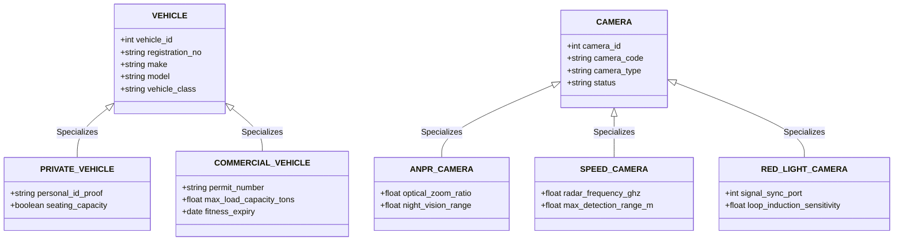

# STVAMS Enhanced Entity-Relationship (EER) Modeling

## Specialization and Generalization Rationale

In STVAMS, Specialization / Generalization hierarchies are implemented to model entity class hierarchies with unique attributes and distinct operational rules.

### 1. VEHICLE Hierarchy (Disjoint & Total Specialization)
* **Supertype:** `VEHICLE`
* **Subtypes:** `PRIVATE_VEHICLE`, `COMMERCIAL_VEHICLE`
* **Rationale:** Commercial vehicles require distinct legal attributes (Commercial Permit Numbers, Gross Vehicle Weight Ratings, Fitness Certificates) and are subject to overloading violation checks (`OVERLOAD_01`), whereas Private Vehicles do not.

### 2. CAMERA Hierarchy (Disjoint Specialization)
* **Supertype:** `CAMERA`
* **Subtypes:** `ANPR_CAMERA`, `SPEED_CAMERA`, `RED_LIGHT_CAMERA`
* **Rationale:** Speed cameras incorporate Doppler Radar frequency attributes, Red-Light cameras interface with traffic signal controller ports, and ANPR cameras store optical OCR calibration parameters.
