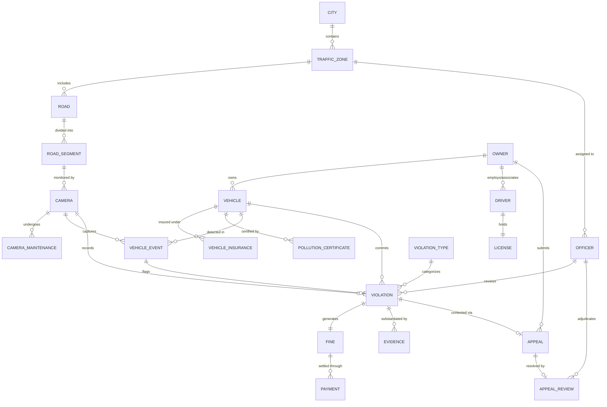

# STVAMS Entity-Relationship (ER) Diagram & Specification

## Conceptual Overview
The Smart Traffic Violation & Vehicle Analytics Management System (STVAMS) relational core comprises 22 normalized entities modeled in Oracle RDBMS.

## Mermaid ER Diagram

## Entity & Cardinality Descriptions

1. **CITY to TRAFFIC_ZONE (1:N)**: A city is partitioned into multiple traffic management zones. Participation is mandatory for zones.
2. **TRAFFIC_ZONE to ROAD (1:N)**: Each zone encompasses one or more roads.
3. **ROAD to ROAD_SEGMENT (1:N)**: Roads are broken down into discrete segments with precise start/end GPS coordinates.
4. **ROAD_SEGMENT to CAMERA (1:N)**: A segment houses optical/AI cameras (ANPR, Speed, Red Light).
5. **OWNER to VEHICLE (1:N)**: An owner (individual/corporate) can own one or many registered vehicles.
6. **DRIVER to LICENSE (1:1)**: A driver holds exactly one active driving license record.
7. **VIOLATION to FINE (1:1)**: Every confirmed violation generates exactly one fine ledger entry.
8. **FINE to PAYMENT (1:N)**: A fine may be settled in full via 1 payment or across multiple partial payment transactions.
9. **VIOLATION to APPEAL (1:1)**: A violation can have at most one appeal submitted by the vehicle owner.
